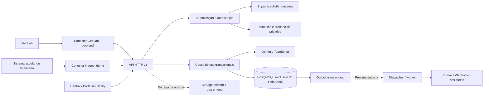

# Help Desk independente — arquitetura consolidada

**Versão do documento:** 1.0 · **Incremento de código:** 0.1.0 · **Data:** 15/09/2026  
**Situação:** arquitetura-alvo definida; primeira fundação implementada localmente; produção não liberada.

## 1. Base da consolidação e limites de evidência

Esta arquitetura usa os dois relatórios anexados pelo usuário e o histórico recuperável da iniciativa “Análise de Helpdesk”. O objetivo original inclui tanto o suporte da Consulte a seus clientes quanto a comunicação entre um laboratório/empresa que utiliza o GeoLab e seus próprios clientes. A íntegra de todas as mensagens anteriores não foi recuperada; não se atribuem ao usuário decisões que aparecem apenas como recomendações nos relatórios.

O relatório A, “Help Desk Genérico e Independente sobre Supabase”, tem 643 linhas. Defende produto independente, conta como fronteira principal de acesso, contratos versionados e API própria. O relatório B, “Deep Research — Help Desk Genérico, Multiproduto e Multicontrato sobre Supabase”, tem 1.280 linhas. Acrescenta workspace, autorização contextual, notas internas em tabela própria, sessões curtas e separação mais forte das responsabilidades. Os arquivos originais acompanham o pacote em `docs/research/`, sem transformar referências e links históricos ali contidos em evidências atuais.

A inspeção conectada desta sessão encontrou o repositório GitHub vazio; projeto Supabase ativo, sem tabelas nos quatro schemas consultados, sem migrations e sem Edge Functions; e um deploy Netlify manual com uma página HTML e nenhuma Function. Não houve leitura completa de todos os schemas, usuários Auth, buckets, backups ou parâmetros de exposição da Data API. Uma consulta SQL de introspecção foi bloqueada pelo ambiente; não se contornou esse bloqueio. A partir dessas evidências, não existe código remoto recuperado que possa ser chamado de implementação anterior do novo Help Desk.

## 2. Decisões consolidadas, sem apagar divergências

| Tema | Relatório A | Relatório B | Decisão desta arquitetura |
|---|---|---|---|
| Fronteira de isolamento | Conta | Workspace + conta | Duas fronteiras complementares: workspace da operação e conta do cliente. |
| Contrato | Separado do tenant | Separado, com versões e cobertura | Preservar contrato, versão e cobertura; contrato nunca é identidade de usuário nem tenant. |
| Runtime | Edge/TypeScript como primeira opção | Node/TypeScript/Fastify preferido | Núcleo TypeScript desacoplado; adaptador Web Request/Response para Netlify. Fastify pode ser um adaptador futuro de servidor dedicado. |
| Mensagem interna | Visibilidade restrita por enum | Tabela própria | `ticket_messages` e `internal_notes` separadas física e funcionalmente. |
| Integração | Chave própria por conexão | Credencial + token curto | Chave longa apenas troca por sessão opaca de até dez minutos; vínculos vivos são consultados a cada requisição. |
| Fila | Outbox + PGMQ | Outbox primeiro; PGMQ opcional | Outbox já modelado; dispatcher e PGMQ entram em entrega própria, sem instalação prematura. |
| Interface | Central e portal | Central, portal e sessão incorporada | Interface inicial única com capacidades por perfil; experiência incorporada fica bloqueada até seu protocolo ser implementado. |
| SLA | Política/calendário versionados | Clocks/eventos independentes | Arquitetura-alvo adota clocks; neste incremento há snapshot de política e função pura de calendário, não SLA operacional. |

A opção por não introduzir Fastify/React no primeiro incremento não é apresentada como conclusão dos relatórios: é uma decisão de implementação desta sessão. Ela reduz dependências necessárias para testar o núcleo e permite usar o contrato nativo de Functions já existente no destino escolhido. A interface inicial usa HTML/CSS/JavaScript; a migração de componentes para React pode ocorrer preservando a API. Isso não dispensa homologação do empacotamento Netlify, do driver PostgreSQL e das dependências. O pacote ainda não tem lockfile gerado e auditado; esse é um bloqueador explícito de release.

## 3. Modelo de negócio: o que cada entidade significa

### Workspace

É a operação de suporte que detém produtos, contas, equipes, contratos, integrações e políticas. Um prestador não recebe direitos sobre outro workspace. Um usuário pode participar de várias operações, com seleção explícita e validação no backend. Não haverá “administrador global” implícito a partir de e-mail, domínio, metadata de JWT ou acesso a uma fila.

### Conta

É o cliente ou organização atendida dentro de um workspace. Duas contas no mesmo workspace também precisam ser isoladas. O papel de solicitante vê seus próprios tickets; o gestor da conta pode ver os tickets da conta; o agente precisa de vínculo com a conta atendida. A condição “trabalha no suporte” não concede automaticamente acesso a todos os clientes.

### Produto, instância e serviço

Produto identifica o sistema/serviço comercial; instância diferencia produção, homologação e desenvolvimento. Serviço identifica a capacidade coberta, como suporte geral, integração ou processamento documental. IDs de obra, laboratório, escola ou empresa externa não viram colunas fixas no núcleo. Referências externas são namespaced por conexão de integração.

### Contrato, versão e cobertura

Contrato representa o vínculo de suporte; sua versão publicada fixa vigência e regras aplicáveis; cobertura associa conta, produto/instância e serviço. A mesma conta pode ter mais de um contrato. Uma versão pode cobrir mais de uma conta dentro do workspace, mediante configuração explícita. Não há cobertura transversal implícita entre workspaces.

Quando há uma cobertura elegível, ela pode ser selecionada automaticamente. Quando há várias, a API retorna ambiguidade e exige seleção. Sem cobertura, este incremento retorna erro; o intake sem contrato é uma entrega futura, sem SLA inventado. A abertura revalida a escolha na mesma transação que cria o ticket. Uma versão publicada não é alterada em lugar: uma alteração exige nova versão. O ticket preserva a versão e um snapshot das regras aplicadas.

### Exemplo que evita um erro de modelagem

Quando a Consulte presta suporte ao Laboratório Horizonte, a Consulte é o workspace e o laboratório é uma conta. Quando o laboratório atende suas construtoras clientes, ele pode ser outro workspace, com suas próprias contas. A entidade externa “laboratório” pode originar mapeamentos diferentes conforme a relação de atendimento; não existe a regra universal `laboratorio_id = workspace_id` ou `laboratorio_id = account_id`. Esses vínculos são administrados no Help Desk e validados pelo conector.

## 4. Arquitetura de execução

O monólito modular concentra as transações de atendimento; não significa um arquivo único nem obrigação de um processo Node permanentemente ativo. O módulo de domínio não importa Netlify, Supabase, driver SQL ou HTML. Casos de uso dependem de `UnitOfWork` e `Store`; adaptadores traduzem essas interfaces para PostgreSQL ou memória de teste. O frontend conhece a API, não tabelas.

Não há microsserviços, Kafka, Redis ou Elasticsearch no incremento inicial. Sua inclusão exige evidência de carga, fronteiras de equipe ou requisito operacional que compense a complexidade. O worker pode migrar para container sem alterar o contrato HTTP ou a semântica do outbox. Processamento pesado de arquivos não deve ser embutido na requisição de abertura de chamado.

### Organização do código entregue

| Local | Responsabilidade |
|---|---|
| `src/domain` | Entidades, autorização, contrato, transições, hash canônico e calendário de referência. |
| `src/application` | Fluxos de criação, consulta, conversa, notas e mudança de estado; portas de persistência. |
| `src/infrastructure` | PostgreSQL, autenticação, configuração segura e adaptador de memória para testes. |
| `src/http` | Entrada limitada, campos permitidos, DTOs públicos e erros seguros. |
| `netlify/functions` | Adaptação para o host; configuração exclusivamente por variáveis de ambiente. |
| `web` | Interface inicial, sem segredo de integração e sem persistência de tokens em localStorage. |
| `supabase/migrations` | Migrations candidatas à homologação, sem aplicação remota automática. |
| `tests` / `supabase/tests` | Testes locais, navegador e PostgreSQL, com resultados separados. |

## 5. Persistência e segurança em profundidade

Os schemas propostos e já presentes nas migrations são `helpdesk_core`, `helpdesk_auth`, `helpdesk_integration` e `helpdesk_audit`. Não se cria nenhuma tabela de domínio em `public`. A configuração efetiva de schemas expostos na Data API ainda deve ser verificada na homologação; o nome privado não substitui essa configuração.

O login de execução é `helpdesk_app`. Ele não pode ser superuser, ter BYPASSRLS ou ser dono das tabelas. É criado inicialmente sem LOGIN; sua habilitação e senha pertencem ao provisionamento seguro, não ao código ou ao chat. A aplicação verifica o papel efetivo ao inicializar. Um username do pooler pode ter sufixo do projeto, mas `current_user` precisa continuar sendo `helpdesk_app`.

Toda unidade de trabalho abre uma transação e configura `app.workspace_id` e `app.principal_id` por `set_config(..., true)`. Esse contexto é transacional e desaparece no commit/rollback. Ele não autentica ninguém: somente o backend confiável pode estabelecê-lo após validar a identidade. Uma aplicação comprometida capaz de executar SQL arbitrário continua sendo uma ameaça; RLS não transforma o backend em componente não confiável.

RLS é habilitado e forçado em todas as tabelas dos schemas. GRANTs são mínimos e separados das policies. Clientes Supabase (`anon`, `authenticated`, `service_role`) não recebem acesso às tabelas privadas. Não há leitura direta das tabelas de credenciais pelo login de request. Helpers `SECURITY DEFINER` são limitados, têm `search_path` vazio e nomes qualificados, e não são concedidos a PUBLIC. O dono das migrations/helpers precisa de BYPASSRLS para ler as tabelas de autorização com FORCE RLS; ele é deliberadamente diferente do login de aplicação.

As FKs compostas impedem que um ticket use conta, instância, serviço ou cobertura de outro contexto. O ticket possui identidade e snapshot imutáveis; atualizações devem incrementar sua versão em uma unidade. A publicação de versão contratual impede alterações retroativas. A consulta autorizada de cobertura trava os registros relevantes durante a transação de criação, sem conceder UPDATE de contratos ao papel da aplicação.

Uma constraint trigger diferida exige que um novo ticket tenha seu evento inicial e sua intenção de outbox antes de confirmar a transação. É uma migration candidata: sintaxe, permissões e comportamento concorrente precisam ser exercitados em PostgreSQL real antes do release.

## 6. Identidades, permissões e fluxo incorporado

### Pessoas

O backend valida o bearer junto a `/auth/v1/user` do projeto Supabase. O identificador retornado é convertido em um principal local por função privada. Papéis e vínculos vêm do banco, nunca de `user_metadata`. A seleção `X-Workspace-Id` precisa corresponder a um vínculo ativo. Um principal de solicitante não se torna agente por enviar o nome de uma fila ou alterar um header.

A tela de login inicial usa o fluxo de senha do Supabase e mantém o access token apenas em memória. Ela ainda não implementa renovação de sessão, convite, recuperação, fatores adicionais ou gestão administrativa. Esses fluxos pertencem à entrega de identidade e são bloqueadores para a operação completa. Sair remove a sessão local; não se anuncia revogação global de todas as sessões Auth como funcionalidade já implementada.

### Integrações de backend

Cada conexão corresponde a uma instância e possui contas explicitamente vinculadas. Uma credencial aleatória `hd_key_...` é mantida somente no backend consumidor e apenas seu SHA-256 é armazenado. Credenciais aleatórias de alta entropia não são senhas humanas. A troca gera um bearer opaco `hd_session_...`, cujo hash fica no banco, com expiração de até dez minutos limitada pela validade da credencial. A cada request, sessão, credencial, conexão, principal e vínculos ativos são consultados. O contexto não é cacheado como autorização permanente.

O protótipo M2M não impersona usuários externos. Tickets de uma conexão pertencem ao principal da integração. `external_identity_bindings` e `support-sessions`, que permitirão uma experiência incorporada por pessoa, ainda não foram implementados. Até essa etapa ser homologada, o segredo de integração não pode ser entregue a um browser e não se deve habilitar um widget consumidor como se a conexão identificasse cada usuário final.

### Matriz do incremento

| Ator | Acesso a tickets | Resposta pública | Nota interna | Alteração de estado |
|---|---|---|---|---|
| Solicitante | Próprios tickets em conta autorizada | Sim, com escopo | Não | Reabrir/encerrar quando resolvido. |
| Gestor da conta | Tickets da conta | Sim, com escopo | Não | Mesma regra de cliente nesta versão. |
| Agente | Apenas contas atribuídas | Sim | Sim | Transições válidas da máquina de estados. |
| Admin do workspace | Contas do próprio workspace | Sim | Sim | Transições válidas; não alcança outro workspace. |
| Integração | Próprios tickets da conexão, instância e contas mapeadas | Sim, com escopo | Nunca | Regra de cliente; não recebe poderes de agente. |

Participantes adicionais, escopos por contrato/fila e delegações temporárias ainda precisam ser desenvolvidos. Até lá, não devem aparecer como permissões aparentemente configuráveis que o backend não aplique.

## 7. API, concorrência e conversas

A API contém 14 operações implementadas em 11 paths. `docs/openapi.json` descreve apenas esse subconjunto: capacidades, configuração publicável, identidade, troca M2M, resolução de contexto, tickets, mensagens, notas, transições e histórico. Operações previstas nos relatórios mas não implementadas não são anunciadas como funcionais.

Criações exigem `Idempotency-Key` entre 16 e 128 caracteres seguros. O registro é particionado por workspace, principal, operação e chave, com hash do payload e resultado. A mesma chave e payload reproduzem o recurso; alterações de conteúdo retornam 409. PostgreSQL usa lock transacional e chave única; o adaptador de memória usa mutex, que não constitui prova do comportamento de locks reais.

Transições exigem `If-Match` com a versão atual. Falta da precondição retorna 428; versão antiga retorna 412. O estado interno é projetado para um conjunto menor de estados públicos. Motivos internos de transição e snapshot integral de política não aparecem no DTO de cliente. Um agradecimento posterior não reabre automaticamente um ticket resolvido. A reabertura exige comando explícito e motivo.

Respostas públicas e notas internas usam endpoints, tabelas e serializers distintos. Uma nota não cria evento externo no outbox. O formulário usa rascunhos separados por modo para reduzir o risco de enviar uma nota como resposta pública. Nenhum conteúdo recebido é inserido na interface como HTML executável. Ainda são necessários testes reais de acessibilidade, navegação, XSS e comportamento do navegador; a tentativa de Playwright nesta sessão foi bloqueada pela política do ambiente.

O tamanho do JSON é limitado durante a leitura do stream a 64 KiB, sem depender apenas de Content-Length. Campos extras são recusados para impedir mass assignment. Erros têm `application/problem+json`, código e ID de correlação, sem SQL, tokens ou stack trace. A paginação de tickets usa cursor por data/ID ligado ao principal e filtro. Mensagens e timeline ainda retornam a coleção do ticket sem paginação; o limite e a paginação dessas coleções são um requisito prioritário antes de crescimento operacional.

## 8. SLA, roteamento, anexos e entregas: fronteiras futuras

### SLA e roteamento

O SLA operacional terá clocks separados de primeira resposta humana, próxima resposta e resolução. Início, pausa, retomada, cumprimento e violação serão eventos auditáveis. Resposta automática não cumprirá SLA humano por padrão. Calendário terá timezone IANA, jornadas, feriados e versões. Uma nova política não recalculará tickets antigos silenciosamente. O campo atual `policy` é um snapshot inicial, não um substituto para esses objetos versionados.

A função de referência `addBusinessMinutes` percorre minutos e possui horizonte limitado; serve para testes de semântica, não para grandes lotes em Functions. Será substituída ou otimizada por cálculo de intervalos e acompanhada de casos de DST, feriados e carga. Fila, acesso e SLA permanecem conceitos independentes. Regras de roteamento terão prioridade, versão, conflitos detectáveis e simulação antes de publicar.

### Anexos

O desenho-alvo é upload privado em quarentena, confirmação, inspeção de tamanho/hash/tipo real, análise antimalware e promoção para objeto limpo. O download depende de autorização atual do ticket e URL assinada curta. Não há endpoint de upload nesta versão. A ausência do scanner nunca libera automaticamente o arquivo. Nota interna com anexo também exige visibilidade interna em todo o pipeline, inclusive exportação e notificação.

### Outbox, worker e webhooks

A intenção de evento já acompanha a transação. Não há dispatcher nem entrega de e-mail/webhook habilitados. O worker deverá ter claim com lease, retentativas com backoff/jitter, ledger por destino, limites por workspace, recuperação de leases abandonadas e dead letters visíveis. PGMQ é opcional depois do dispatcher inicial; não substitui a intenção transacional.

A assinatura de webhook cobrirá timestamp, identificador de evento/entrega e bytes exatos do corpo, com segredo por assinatura. Destinos precisam de validação contra SSRF, inclusive DNS e redirecionamentos. O consumidor deve deduplicar eventos: timeout após processamento externo não permite prometer exactly-once. O worker terá identidade distinta de `helpdesk_app`; não se amplia o papel de request para drenar globalmente o outbox.

## 9. Operação, ambiente e governança

Netlify serve a interface e o adaptador HTTP; Supabase mantém o banco exclusivo. API e frontend têm a mesma origem; este incremento não acrescenta CORS aberto. Uma origem incorporada futura exigirá allowlist e protocolo próprios. O CSP inicial permite a URL Auth do projeto escolhido. Não foi alterada configuração remota, MFA, segredo ou região.

O banco está em `ca-central-1`, conforme consulta conectada. Isso não comprova residência de todos os dados no Canadá: o deploy Netlify informa região de Functions separada, e e-mail, observabilidade, backups e scanner podem ter outros destinos. A aprovação de regiões, subprocessadores, retenção e transferências pertence à governança do produto. Não há parecer jurídico nesta entrega.

São obrigatórios antes da operação completa: limite distribuído por identidade/workspace, proteção contra abuso da troca de tokens, lifecycle de sessões, métricas por operação, alertas de fila e SLA, trilha administrativa efetiva, backup de banco e de objetos, restauração ensaiada, RPO/RTO aprovados e revisão independente de segurança. Logs estruturados de request sem conteúdo já estão previstos no runtime; OpenTelemetry, dashboards e alertas ainda não estão implantados.

## 10. Referências técnicas externas verificadas nesta sessão

- Supabase — Securing your API: https://supabase.com/docs/guides/api/securing-your-api
- Supabase — Securing your data: https://supabase.com/docs/guides/database/secure-data
- PostgreSQL 17 — Explicit Locking: https://www.postgresql.org/docs/17/explicit-locking.html
- PostgreSQL 17 — Row Security Policies: https://www.postgresql.org/docs/17/ddl-rowsecurity.html
- Netlify — Functions overview: https://docs.netlify.com/build/functions/overview/
- Netlify — Functions configuration: https://docs.netlify.com/build/functions/optional-configuration/

As fontes sustentam os recursos das plataformas. A escolha das fronteiras de domínio, do escopo incremental e das prioridades é a proposta de engenharia desta entrega, e não um fato atribuído automaticamente aos fornecedores.
