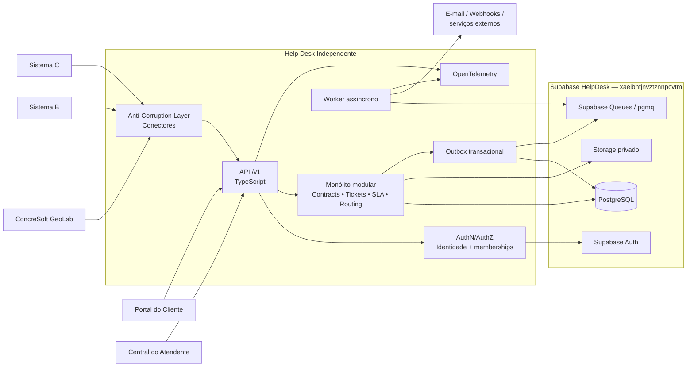
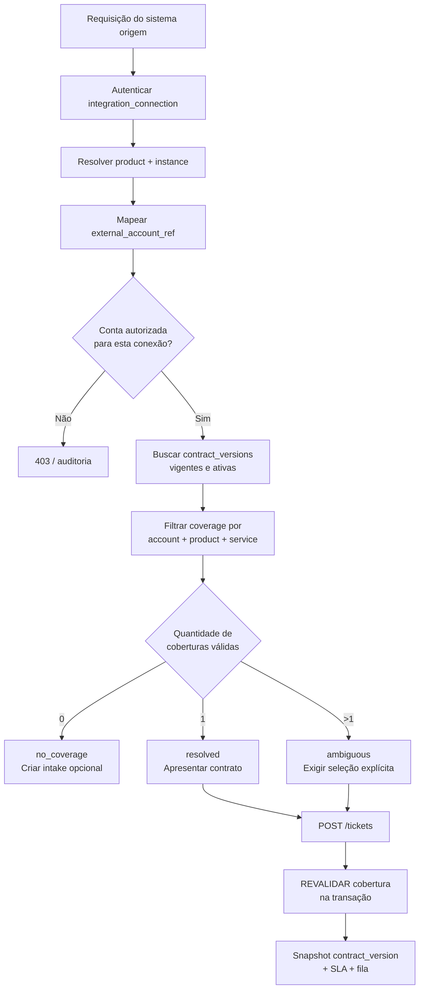
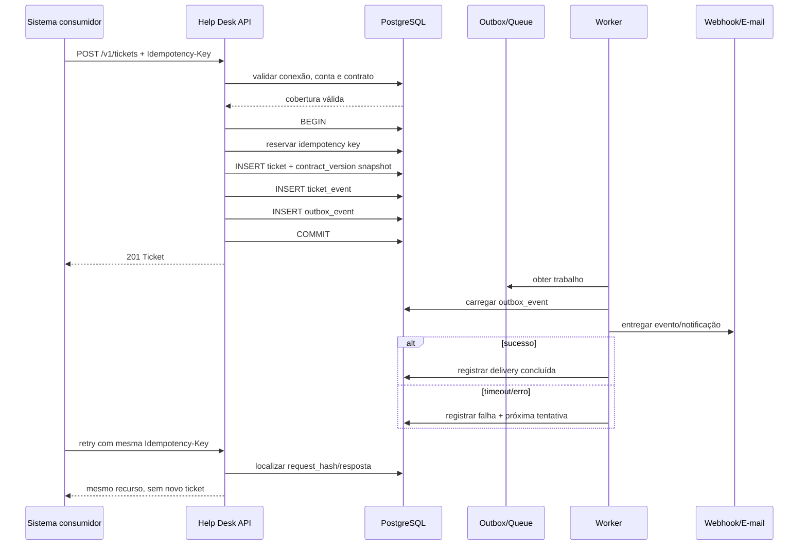
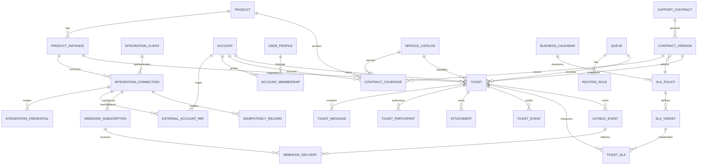

# Help Desk Genérico e Independente sobre Supabase — Pesquisa, Arquitetura e Especificação Técnica

## Resumo Executivo

A pesquisa reforça a direção definida nas análises anteriores, mas permite refiná-la: **o Help Desk deve ser tratado como um produto independente, multiproduto e multicontrato, com domínio e banco próprios no projeto Supabase `xaelbntjnvztznnpcvtm`, sem compartilhar o modelo de dados dos sistemas atendidos**. O ConcreSoft GeoLab será apenas um consumidor da plataforma, exatamente como poderão ser EnergyPRO, sistemas financeiros, aplicações futuras ou produtos externos.

A arquitetura que recomendo é um **monólito modular orientado a domínio, com processamento assíncrono separado**, usando o Supabase como plano principal de dados: PostgreSQL para o domínio, Supabase Auth para identidade humana, Storage privado para anexos e Supabase Queues/`pgmq` para trabalho assíncrono. A API deve possuir contrato HTTP próprio e versionado; os sistemas consumidores **não devem acessar diretamente tabelas de negócio do Help Desk**. O padrão *Anti-Corruption Layer* é apropriado exatamente porque os sistemas integrados têm semânticas distintas; a Microsoft recomenda essa camada para traduzir modelos entre subsistemas sem permitir que o domínio de um contamine o outro. citeturn23view0

A recomendação **não é iniciar com microsserviços**. Ticket, contrato, SLA, mensagens, autorização e outbox têm forte coesão transacional. Fragmentá-los inicialmente aumentaria o número de falhas distribuídas, credenciais, contratos de rede e problemas de consistência sem que escala, tamanho da equipe ou volume — todos ainda não especificados — justifiquem isso. O *transactional outbox* existe justamente para resolver o problema de gravar uma transação e publicar uma notificação de forma confiável. citeturn22search5turn22search1

Ao mesmo tempo, **“monólito modular” e “serverless” não são conceitos mutuamente exclusivos**: o primeiro define fronteiras do software; o segundo define uma forma de execução. A primeira versão pode executar APIs TypeScript em Supabase Edge Functions e consumir Supabase Queues, mantendo módulos internos claros. Tarefas pesadas — antivírus, grandes exportações, processamento demorado — devem poder migrar para um worker em container sem alterar o contrato público. Edge Functions possuem limites de CPU, memória e duração que precisam ser considerados; portanto, não é prudente transformar qualquer processamento arbitrário em Edge Function. citeturn14search5turn14search0

O modelo de multitenancy recomendado é **banco compartilhado e tabelas compartilhadas, com `account_id` explícito, autorização por recurso e RLS como defesa em profundidade**, e não um banco ou schema para cada contrato. A OWASP reconhece múltiplas estratégias de isolamento; em um Help Desk com potencialmente muitos clientes, o modelo compartilhado é operacionalmente eficiente, desde que o contexto do tenant seja validado pelo servidor, nunca aceito apenas porque veio do cliente, e que testes negativos de acesso entre tenants façam parte do pipeline. citeturn22search2

O **contrato de suporte não deve ser o tenant**. Esta distinção é decisiva. Uma conta pode ter vários contratos, um contrato pode cobrir vários produtos ou serviços, e um ticket precisa guardar a **versão contratual efetivamente aplicada no momento da abertura**. Isso evita que uma alteração futura no contrato reescreva silenciosamente o SLA histórico do chamado. A modelagem da ServiceNow é uma boa referência conceitual: seus SLAs de atendimento podem ser associados a contrato de serviço, empresa e produto e possuir condições de início, pausa e encerramento. citeturn19search1

A API de integração deve usar **idempotência, webhooks assinados, versionamento e OpenAPI**. A versão mais recente da especificação OpenAPI é a **3.2.1, publicada em 10 de setembro de 2026**; para o primeiro contrato executável, entretanto, proponho deliberadamente OpenAPI 3.1.1 até que a cadeia escolhida de validadores, geradores de clientes e gateways seja homologada com 3.2.1. OpenAPI fornece uma descrição independente de linguagem da interface HTTP e permite geração de documentação, consumidores e testes. citeturn24search0

A API de máquina para máquina também **não deve depender de `client_credentials` do Supabase Auth**, pois o servidor OAuth do Supabase documenta Authorization Code + PKCE e Refresh Token e não oferece `client_credentials`. Para a primeira versão, recomendo credenciais por conexão de integração, rotacionáveis, escopadas e armazenadas apenas como hash; HMAC de requisição pode ser acrescentado para integrações de maior sensibilidade. citeturn12search0turn12search8

Para eventos, notificações e integrações assíncronas, proponho um envelope inspirado em **CloudEvents**, que padroniza metadados de eventos e possui SDKs para JavaScript, Go, C# e outras linguagens. Isso é particularmente conveniente para uma plataforma que pretende conversar com sistemas heterogêneos. citeturn24search2

### Estado verificado do Supabase

Fiz apenas consultas **read-only** no projeto indicado nesta sessão. O projeto `xaelbntjnvztznnpcvtm`, denominado **HelpDesk**, está `ACTIVE_HEALTHY`, em `ca-central-1`, atualmente com PostgreSQL `17.6.1.166`. A consulta retornou **zero tabelas em `public`, zero migrations registradas e zero Edge Functions**. O `pgmq` está disponível entre as extensões, mas ainda não está instalado. Nenhuma alteração foi realizada.

Há, entretanto, um achado que muda a interpretação de “projeto vazio”: o **Security Advisor detectou a função `public.rls_auto_enable()` como `SECURITY DEFINER` executável tanto por `anon` quanto por `authenticated`**. Antes de colocar qualquer dado real no ambiente, esse objeto deve ser analisado e, se a exposição não for intencional, ter `EXECUTE` revogado ou ser retirado do schema exposto. O alerta corresponde às recomendações oficiais do Supabase de não deixar funções privilegiadas indevidamente expostas pela Data API. citeturn2search1turn2search5

A região do projeto é Canadá (`ca-central-1`). Como a política de residência de dados **não foi especificada**, não concluo que isso seja correto ou incorreto; considero a aprovação formal da região um **gate anterior à entrada de dados reais de clientes**.

**Decisão recomendada:** construir um núcleo próprio e genérico no projeto HelpDesk, preservando o GeoLab como primeiro consumidor importante, mas exigir a integração de pelo menos um segundo produto semanticamente diferente como critério de comprovação da genericidade.

## Metodologia de Pesquisa

A pesquisa foi realizada em 15 de setembro de 2026, priorizando documentação oficial, especificações, projetos GitHub originais e organizações reconhecidas de segurança. Para arquitetura e segurança, foram priorizados Supabase, PostgreSQL/Supabase Queues, OWASP, Microsoft Architecture Center, AWS Prescriptive Guidance, OpenAPI Initiative, CNCF/CloudEvents e OpenTelemetry. Para modelagem funcional, foram examinados Jira Service Management, Zendesk, Freshdesk e ServiceNow. Para alternativas open source, foram analisados os repositórios originais de Zammad, Chatwoot, FreeScout e GLPI. citeturn22search2turn23view0turn22search1turn24search0turn22search3

A investigação procurou separar três classes de evidência: **comportamento documentado por fonte oficial**, **estado efetivamente lido no Supabase conectado** e **recomendação arquitetural**, que representa uma conclusão de engenharia a partir dessas evidências. Não foram feitos testes de carga, pentest, restauração, alterações DDL, criação de Edge Functions, instalação de extensões ou mudanças em configuração.

Fontes prioritárias para continuidade do projeto:

| Tema | Fonte prioritária |
|---|---|
| Segurança Supabase/RLS | [Supabase — Row Level Security](https://supabase.com/docs/guides/database/postgres/row-level-security) |
| Exposição da Data API | [Supabase — Securing your API](https://supabase.com/docs/guides/api/securing-your-api) |
| Schemas da Data API | [Supabase — Custom Schemas](https://supabase.com/docs/guides/api/using-custom-schemas) |
| Filas | [Supabase Queues](https://supabase.com/docs/guides/queues) |
| Backup | [Supabase — Database Backups](https://supabase.com/docs/guides/platform/backups) |
| OAuth | [Supabase OAuth Flows](https://supabase.com/docs/guides/auth/oauth-server/oauth-flows) |
| Segurança multi-tenant | [OWASP Multi-Tenant Security Cheat Sheet](https://cheatsheetseries.owasp.org/cheatsheets/Multi_Tenant_Security_Cheat_Sheet.html) |
| Segurança REST | [OWASP REST Security Cheat Sheet](https://cheatsheetseries.owasp.org/cheatsheets/REST_Security_Cheat_Sheet.html) |
| Upload de arquivos | [OWASP File Upload Cheat Sheet](https://cheatsheetseries.owasp.org/cheatsheets/File_Upload_Cheat_Sheet.html) |
| Integração de domínios | [Microsoft — Anti-Corruption Layer](https://learn.microsoft.com/en-us/azure/architecture/patterns/anti-corruption-layer) |
| Confiabilidade assíncrona | [AWS — Transactional Outbox, pt-BR](https://docs.aws.amazon.com/pt_br/prescriptive-guidance/latest/cloud-design-patterns/transactional-outbox.html) |
| Contrato HTTP | [OpenAPI Specification](https://spec.openapis.org/oas/latest) |
| Eventos | [CloudEvents](https://cloudevents.io/) |
| Observabilidade | [OpenTelemetry](https://opentelemetry.io/docs/what-is-opentelemetry/) |
| Help Desk OSS | [Zammad](https://github.com/zammad/zammad), [Chatwoot](https://github.com/chatwoot/chatwoot), [FreeScout](https://github.com/freescout-help-desk/freescout), [GLPI](https://github.com/glpi-project/glpi) |

Supabase Queues merece atenção especial. É uma fila durável baseada em PostgreSQL/`pgmq`, integrada ao próprio projeto e com janela de visibilidade e arquivamento. Embora a documentação utilize a expressão “exactly once” dentro da janela de visibilidade, isso **não elimina a necessidade de consumidores idempotentes para efeitos externos**, como e-mail ou chamadas HTTP; a plataforma deve continuar preparada para retries e resultados incertos de rede. citeturn14search0turn14search2turn14search3

OpenTelemetry foi selecionado como padrão de instrumentação porque é neutro de fornecedor e cobre traces, métricas e logs; o protocolo OTLP encontra-se estável para esses três sinais. Isso permite trocar o backend de observabilidade sem redefinir a instrumentação do Help Desk. citeturn22search3turn22search19

## Achados

Os produtos maduros convergem em alguns conceitos importantes: **fila de trabalho, classificação estruturada, respostas públicas distintas de comunicação interna, automação, calendário e SLA configuráveis**. Jira Service Management, por exemplo, modela SLA com metas, calendários e condições de início/pausa/parada; o calendário tem timezone, dias, períodos de trabalho e feriados. citeturn18search5turn18search1turn18search11

Freshdesk reforça outro ponto relevante ao cenário multiproduto: Workspaces podem possuir seus próprios agentes, grupos, horários, políticas de SLA e automações; tickets que mudam de Workspace passam a adotar regras do destino. Essa capacidade é um bom benchmark para isolamento operacional, embora no Help Desk proposto eu recomende preservar o snapshot contratual histórico em vez de recalcular silenciosamente compromissos antigos. citeturn17search3

ServiceNow é a referência comercial mais próxima do problema específico de **“qual contrato cobre este atendimento?”**, porque permite relacionar SLA de caso a contrato de serviço, empresa e produto. Essa constatação sustenta a decisão de tornar `support_contract` e `contract_version` entidades de primeira classe, e não campos textuais em `ticket`. citeturn19search1

| Solução | Tipo | O que vale usar como benchmark | Limitação para este projeto | Avaliação |
|---|---|---|---|---|
| **Jira Service Management** | Comercial | Filas, request types, metas, condições e calendários de SLA. citeturn18search5turn18search1 | Domínio e integração permanecem ligados ao ecossistema Jira. | Excelente referência de workflow/SLA. |
| **Zendesk** | Comercial | Modelo maduro de tickets, automações, comentários públicos/notas internas e políticas de SLA. | Customização profunda passa pelo modelo da plataforma. | Excelente referência de UX de atendimento. |
| **Freshdesk** | Comercial | Workspaces, grupos, roteamento, produtos, horários e SLAs isolados por operação. citeturn17search3turn17search4 | O modelo de Workspace não equivale exatamente ao contrato de suporte proposto. | Ótima referência multiproduto. |
| **ServiceNow CSM** | Comercial | Relação explícita entre caso, contrato, empresa, produto e SLA. citeturn19search1 | Complexidade e escopo enterprise muito superiores ao necessário para um MVP próprio. | Melhor benchmark para contratos. |
| **Zammad** | OSS/AGPL | Helpdesk web multicanal, REST API, tickets e ecossistema ativo. O repositório oficial permanece ativo em 2026. citeturn21view0turn25search0 | Adotá-lo significa adotar seu domínio e stack, não um schema Supabase desenhado para seus contratos. | Melhor candidato OSS para POC tradicional. |
| **Chatwoot** | OSS | Atendimento omnichannel e grande foco em conversas/canais; possui GitHub Discussions para self-hosting. citeturn21view1turn25search1 | Mais orientado a conversas/inbox que a contratos e SLA complexos. | Excelente referência de canais/UX. |
| **FreeScout** | OSS | Help desk/shared inbox self-hosted e relativamente enxuto. citeturn21view2 | Menor aderência ao modelo contratual e API-first pretendido. | Boa referência para simplicidade. |
| **GLPI** | OSS | IT service desk combinado a gestão de ativos e conceitos ITIL. citeturn21view3 | Escopo de ITAM/CMDB é maior e diferente do problema inicial. | Útil quando ativos/ITSM forem requisito. |

Minha conclusão não é que “desenvolver sempre é melhor”. Zammad e Chatwoot mereceriam uma POC se o objetivo principal fosse simplesmente implantar atendimento tradicional. **Neste caso específico**, porém, o diferencial pedido é uma camada genérica que resolva contratos, tenants e produtos vindos de sistemas independentes usando um banco Supabase próprio; adaptar um helpdesk pronto pode acabar invertendo a dependência, obrigando os sistemas a se adequarem ao modelo do produto OSS. Essa é uma inferência arquitetural a partir dos modelos e stacks desses projetos. citeturn21view0turn21view1turn23view0

**Comparação arquitetural:**

| Opção | Vantagens | Desvantagens | Adequação |
|---|---|---|---|
| **Monólito modular + worker** | Transações simples; uma fonte de verdade; menor custo operacional; módulos podem ser extraídos mais tarde. | Exige disciplina para preservar fronteiras internas. | **Recomendado.** |
| **Microsserviços desde o início** | Deploy e escala independentes por domínio; isolamento de falhas quando bem projetado. | Auth entre serviços, observabilidade distribuída, duplicação de contratos, outbox/eventos e consistência distribuída aparecem desde o primeiro dia. | Prematuro enquanto volume/equipe não justificarem. |
| **Serverless puro** | Baixa administração de servidores e integração direta com Supabase. | Limites de execução tornam trabalhos pesados ou longos menos confortáveis. citeturn14search5 | Bom para API e jobs curtos; não deve impedir worker externo futuro. |
| **Híbrido Supabase + container worker** | Preserva simplicidade do Supabase e permite tarefas longas/CPU intensivas. | Acrescenta uma unidade operacional. | **Destino provável quando anexos/canais crescerem.** |

Microsserviços podem ser apropriados no futuro quando houver equipes independentes, requisitos de escala diferentes ou domínios que realmente precisem de ciclo de vida separado. O ponto é adiar essa decisão até haver evidência. Padrões distribuídos trazem benefícios, mas também introduzem transações locais, compensação, mensageria e observabilidade distribuída. citeturn22search17turn22search34

**Comparação das stacks:**

| Stack | Pontos fortes para este Help Desk | Trade-off | Recomendação |
|---|---|---|---|
| **TypeScript + Supabase Edge** | Alinhamento direto com o ecossistema Supabase; SDK oficial; fácil compartilhamento de DTOs; CloudEvents possui SDK JS. citeturn14search5turn24search2 | Runtime Edge tem limites; não é um processo Node tradicional de longa duração. | **Primeira escolha para API inicial.** |
| **Node.js + TypeScript em container** | Mesmo modelo de tipos da opção anterior, sem os limites operacionais de Edge para workers persistentes. | Infra de compute fora do projeto Supabase. | **Primeira escolha para worker e alternativa para toda a API.** |
| **.NET** | Forte modelagem tipada e excelente opção para equipes C#; CloudEvents suporta C# e OTel é multiplataforma. citeturn24search2turn22search3 | API precisará rodar fora do Edge Runtime do Supabase. | Excelente se C# for competência dominante da equipe. |
| **Go** | Binários pequenos, bom perfil para gateways e workers concorrentes; CloudEvents possui SDK Go. citeturn24search2 | Menor reaproveitamento direto de tipos com frontend TypeScript. | Excelente para worker/gateway de alto volume, sem necessidade no MVP. |

Como orçamento, equipe e experiência interna não foram informados, **Node/TypeScript não deve virar dogma**. A recomendação é baseada no menor atrito inicial com Supabase e aplicações web; uma equipe significativamente mais madura em .NET pode construir a mesma arquitetura sem comprometer o modelo.

**Bibliotecas e padrões com maior valor prático:** Supabase JS para Auth/Storage/API quando aplicável; `pgmq`/Supabase Queues para trabalho assíncrono; OpenTelemetry para instrumentação; OpenAPI como contrato HTTP; CloudEvents como envelope de eventos; e pgTAP/testes de RLS para validar segurança do banco. Supabase recomenda testar políticas e lembra que `service_role` ignora RLS, razão pela qual esse papel não deve ser usado como identidade normal do request path. citeturn2search5turn14search0turn22search3turn24search0turn24search2

**Comunidades úteis e atualmente ativas:** o fórum oficial do Zammad apresentava discussões e solicitações com atividade em setembro de 2026; Chatwoot mantém GitHub Discussions; Atlassian possui sua Community vinculada diretamente à documentação de JSM; e Supabase mantém Discord e seus repositórios GitHub como canais comunitários. citeturn25search0turn25search1turn18search5turn25search3

## Arquitetura Recomendada

O princípio central é: **os sistemas externos conhecem a API; a API conhece o domínio do Help Desk; conectores/ACL conhecem as peculiaridades de cada origem**.



A ACL deve fazer **tradução**, não acumular regras de negócio. Por exemplo, `laboratorio_id` do GeoLab pode virar `external_account_ref`; em outro sistema, `empresa_codigo` pode cumprir o mesmo papel. A ACL resolve essas diferenças e entrega ao núcleo `account_id`, produto, instância e contexto padronizado. A Microsoft alerta que a camada adiciona latência e operação adicional e deve ser observável, mas justamente evita que modelos externos deformem o modelo central. citeturn23view0

**Schemas propostos:** `core` para entidades do domínio; `integration` para clientes, credenciais, referências externas e idempotência; `audit` para trilhas e entregas; e, somente se necessário, um schema `api` com RPCs/views explicitamente publicáveis. Não recomendo colocar as tabelas de negócio em `public`. O Supabase permite configurar os schemas expostos, e sua documentação recomenda combinar privilégios SQL e RLS, em vez de pressupor que a Data API esteja automaticamente segura. citeturn2search1turn2search2

**Isolamento recomendado:** `account_id` deve aparecer explicitamente nos recursos tenant-scoped; FK e índices devem acompanhar esse contexto quando necessário. O tenant vindo no body/header é apenas uma **pista para resolução**, nunca autorização. A aplicação verifica se o ator possui vínculo com aquela conta e recurso. RLS funciona como segunda barreira. A OWASP recomenda estabelecer o contexto do tenant cedo, validá-lo contra a identidade autenticada e impedir que cache, filas e jobs assíncronos percam esse contexto. citeturn22search2

Não utilizar `service_role` ou outro papel com `BYPASSRLS` no caminho comum de requisições tenant-scoped. A documentação do Supabase é explícita sobre o fato de chaves privilegiadas ignorarem RLS e não poderem ser expostas a clientes. citeturn2search5

**Autenticação humana:** Supabase Auth pode prover a identidade. Papéis e vínculos efetivos ficam no banco (`account_membership`, equipes e capacidades). Informações de autorização críticas não devem depender exclusivamente de claims antigos em JWT, porque mudanças de associação podem não aparecer até renovação do token. A própria documentação de RLS do Supabase ressalta a questão de atualização dos dados presentes no JWT. citeturn2search5

**Autenticação máquina-a-máquina:** cada `integration_connection` recebe credencial própria com `key_id`, segredo de alta entropia exibido uma única vez e apenas hash persistido. A credencial deve possuir escopos, validade, rotação, último uso e revogação. Para integrações sensíveis, pode-se assinar método, caminho, timestamp e hash do corpo por HMAC. HTTPS continua obrigatório para APIs REST. citeturn22search14turn24search13

**Resolução de contrato:**



Um `external_contract_ref` enviado pelo GeoLab **não concede acesso** e não é suficiente para escolher contrato. Ele é namespaced pela conexão de origem e utilizado apenas para localizar registros previamente mapeados. Esse comportamento segue o princípio OWASP de tratar identificadores enviados pelo cliente como seletores a serem autorizados, não como prova de autorização. citeturn22search2turn5view1

A revalidação em `POST /tickets` elimina uma classe de *time-of-check/time-of-use*: o contrato pode ter sido suspenso ou expirado entre a resolução e a gravação. A criação deve fixar `contract_version_id`, `sla_policy_id` aplicável, calendário e informações necessárias para reproduzir a decisão.

**SLA:** não armazenar apenas um `due_at`. Deve existir `ticket_sla` e uma trilha capaz de explicar início, pausa, retomada, conclusão e calendário. Jira demonstra a importância de condições separadas de início, pausa e parada, além de calendário com timezone, jornada e feriados. citeturn18search1turn18search11

**Estado do ticket recomendado:** `new → triage → in_progress → waiting_customer/waiting_third_party → resolved → closed`, com `reopened` como transição, não necessariamente como estado permanente. A definição final precisa ser configurável em alguma medida, mas não recomendo permitir máquinas de estado arbitrárias no primeiro release.

**Sequência de abertura confiável:**



O ticket e a intenção de notificar precisam ser gravados na **mesma transação**. O e-mail ou webhook não participa dessa transação; isso seria um *dual write*. O outbox transforma a entrega externa em processamento posterior recuperável. citeturn22search5turn22search1

Supabase Queues pode ser usado depois do outbox para distribuir o trabalho. Por ser baseado em Postgres/`pgmq`, reduz a necessidade de introduzir Kafka, RabbitMQ ou SQS no primeiro estágio. A fila deve continuar privada e consumida pelo backend/worker; a própria documentação observa que queues não ficam expostas na Data API por padrão. citeturn14search0turn14search3

**Anexos:** bucket privado, nome de objeto opaco, vínculo no banco e URL assinada temporária somente após autorização do ticket. Extensão, MIME informado e conteúdo real não devem ser considerados equivalentes; limites de tamanho, lista permitida, nome aleatório e inspeção de arquivo são controles recomendados pela OWASP para uploads. citeturn5view3

Backup do banco e dos anexos deve ser tratado separadamente. O backup do PostgreSQL oferecido pelo Supabase **não inclui os objetos do Storage**, apenas seus metadados; restaurar o banco não recupera um arquivo Storage já eliminado. Portanto, qualquer RPO/RTO sério exige procedimento adicional para objetos. citeturn1search3

**Observabilidade:** todo request deve receber `trace_id/correlation_id`; ticket, delivery e job devem permitir correlação sem colocar conteúdo sensível nos logs. Métricas mínimas: latência/erro da API, resolução de contrato ambígua/falha, backlog/idade da fila, retries, webhooks com erro, criação de tickets, SLA próximo do vencimento e taxa de violação. OpenTelemetry permite unificar traces, métricas e logs e correlacioná-los por contexto. citeturn22search3turn22search7

## Requisitos Revisados

As prioridades abaixo usam **P0 = necessário para produção**, **P1 = necessário para operação madura da primeira versão** e **P2 = evolução**. A priorização incorpora princípios de isolamento tenant, API segura, outbox, filas, SLA e Storage discutidos acima. citeturn22search2turn22search14turn22search1turn18search5

| ID | Pri. | Requisito | Critério resumido |
|---|---|---|---|
| GEN-01 | P0 | Help Desk possuir banco e ciclo de vida independentes dos sistemas clientes. | Desligar GeoLab não impede administração de tickets já existentes. |
| GEN-02 | P0 | Nenhuma tabela específica de laboratório, obra, escola etc. no núcleo. | Segundo produto integra sem migration de domínio específica. |
| GEN-03 | P0 | Produto e instância de produto serem entidades explícitas. | Produção/homologação e produtos diferentes são distinguíveis. |
| TEN-01 | P0 | `account` ser a fronteira tenant principal. | Recursos tenant-scoped possuem associação verificável à conta. |
| TEN-02 | P0 | Acesso cruzado entre contas ser negado no servidor e banco. | Testes negativos A→B passam em ticket, mensagem e anexo. |
| TEN-03 | P0 | Tenant enviado pelo cliente não constituir autorização. | Alterar `account_id` manualmente não promove acesso. |
| CON-01 | P0 | Contrato de suporte ser entidade independente da conta. | Conta pode ter N contratos. |
| CON-02 | P0 | Contrato possuir versões e vigência. | Alteração relevante gera nova `contract_version`. |
| CON-03 | P0 | Cobertura relacionar conta, produto e serviço. | Resolver só retorna contratos que cobrem o contexto. |
| CON-04 | P0 | Resolver ambiguidades explicitamente. | Mais de um contrato retorna `ambiguous`. |
| CON-05 | P0 | Ausência de cobertura não inventar contrato. | Permite intake sem SLA contratual ou rejeição conforme política. |
| CON-06 | P0 | Criação revalidar contrato. | Contrato suspenso após `resolve` é recusado em `create`. |
| CON-07 | P0 | Ticket preservar versão contratual aplicada. | Nova versão contratual não altera ticket histórico. |
| IAM-01 | P0 | Pessoas e integrações usarem mecanismos de autenticação distintos. | Token humano não vira credencial de integração e vice-versa. |
| IAM-02 | P0 | Memberships e permissões efetivas residirem no banco. | Revogação não depende exclusivamente de claim antiga. |
| IAM-03 | P0 | Credenciais S2S serem escopadas, rotacionáveis e revogáveis. | Duas conexões do mesmo produto podem ser revogadas separadamente. |
| IAM-04 | P0 | Chaves privilegiadas Supabase nunca chegarem ao browser. | Scan de bundle/log/repo não encontra secret/service key. |
| API-01 | P0 | API pública ser `/v1` e documentada por OpenAPI. | CI valida o documento e contract tests. |
| API-02 | P0 | Operações criadoras suportarem `Idempotency-Key`. | Retry não cria recurso duplicado. |
| API-03 | P0 | API utilizar paginação por cursor nas coleções grandes. | Paginação permanece estável com novas inserções. |
| API-04 | P0 | Erros possuírem `code`, mensagem segura e correlation ID. | Nenhum stack trace/SQL interno é exposto. |
| TKT-01 | P0 | Ticket possuir estado, prioridade, conta, origem, contrato, serviço e fila. | Campos obrigatórios existem e são consistentes. |
| TKT-02 | P0 | Resposta pública e nota interna serem semanticamente distintas. | Cliente nunca recebe nota interna em API/export/webhook. |
| TKT-03 | P0 | Mudanças relevantes gerarem `ticket_event`. | Estado, prioridade, fila e contrato são auditáveis. |
| SLA-01 | P0 | SLA ser baseado em versão de política e calendário. | Cálculo pode ser reproduzido historicamente. |
| SLA-02 | P0 | Suportar início/pausa/retomada/fim. | `waiting_customer` pode pausar apenas políticas configuradas. |
| SLA-03 | P0 | Calendário possuir timezone, jornadas e feriados. | Testes de fronteira temporal passam. |
| ROU-01 | P0 | Routing ser separado de autorização. | Mover ticket para fila não concede acesso a usuários indevidos. |
| ROU-02 | P1 | Routing usar regras ordenadas e auditáveis. | Cada escolha de fila informa regra aplicada. |
| FIL-01 | P0 | Anexos ficarem em bucket privado. | URL pública permanente não existe. |
| FIL-02 | P0 | Download exigir autorização do ticket. | Conhecer storage key não concede download. |
| FIL-03 | P0 | Upload possuir política de tamanho/tipo/inspeção. | Arquivos proibidos são rejeitados ou quarentenados. |
| EVT-01 | P0 | Ticket + evento de outbox serem atômicos. | Não existe ticket que “esqueceu” a intenção de notificar. |
| EVT-02 | P0 | Worker ser idempotente e retentável. | Reprocessar mensagem não duplica efeitos lógicos. |
| EVT-03 | P0 | Webhooks possuírem ID estável, timestamp e assinatura. | Corpo adulterado/assinatura inválida são recusáveis pelo consumidor. |
| OBS-01 | P0 | API e worker emitirem telemetria correlacionada. | Um ticket pode ser seguido de request até delivery. |
| OBS-02 | P1 | Alertar fila envelhecida, erros e SLAs em risco. | Alarmes possuem limiares aprovados. |
| BCP-01 | P0 | Backup de DB e objetos Storage possuir estratégia explícita. | Restore de ambos é exercitado. |
| BCP-02 | P0 | RPO/RTO serem definidos antes da produção. | Critérios deixam de estar “não especificados”. |
| SEC-01 | P0 | Revisar `public.rls_auto_enable()` antes de dados reais. | Nenhum `SECURITY DEFINER` indesejado é executável por `anon/authenticated`. |
| SEC-02 | P0 | RLS e GRANTs terem testes automatizados. | Matriz de autorização roda no CI. |
| UX-01 | P1 | Cliente poder abrir ticket sem entender contrato quando houver única cobertura. | Seleção aparece somente em ambiguidade. |
| UX-02 | P1 | Sistema consumidor poder incluir contexto diagnóstico controlado. | Usuário visualiza/confirma contexto sensível quando necessário. |
| ADM-01 | P1 | Backoffice administrar produtos, contas, contratos, filas e SLAs. | Alterações geram audit log. |
| INT-01 | P1 | Disponibilizar SDK/exemplos de integração. | GeoLab e segundo sistema passam os mesmos contract tests. |
| KB-01 | P2 | Base de conhecimento independente. | Artigos podem ser vinculados a produto/serviço. |
| AI-01 | P2 | IA ser opcional e nunca condição para atendimento humano. | Desativar IA não impede abertura/resposta de ticket. |
| CHN-01 | P2 | Adicionar canais como WhatsApp/chat/e-mail inbound. | Canal converte entrada para o mesmo modelo de ticket/conversa. |

Um requisito adicional de produção deve ser formalizado fora do software: **aprovar residência de dados**. A aplicação já está em `ca-central-1`; essa decisão não deve permanecer implícita.

## OpenAPI simplificado e Modelo de Dados

A especificação abaixo usa OpenAPI **3.1.1 por compatibilidade pragmática de tooling**, embora a versão atual do padrão seja 3.2.1, publicada em 10 de setembro de 2026. A migração para 3.2.x deve ocorrer após validar code generator, validator, gateway e documentação utilizados pelo projeto. citeturn24search0

Artefatos para download:

**[OpenAPI YAML](sandbox:/mnt/data/helpdesk_deep_research/helpdesk-openapi-simplificado.yaml)** · **[Modelo ER Mermaid](sandbox:/mnt/data/helpdesk_deep_research/helpdesk-modelo-er.mmd)** · **[Checklist de homologação](sandbox:/mnt/data/helpdesk_deep_research/helpdesk-checklist-homologacao.md)**

O mapa inicial de endpoints é:

| Método | Endpoint | Escopo |
|---|---|---|
| GET | `/v1/capabilities` | Descoberta de recursos/versão |
| POST | `/v1/contexts/resolve` | Resolver conta, produto e cobertura |
| GET | `/v1/contracts` | Contratos autorizados no contexto |
| POST | `/v1/intakes` | Triagem sem cobertura resolvida |
| GET/POST | `/v1/tickets` | Listar/criar tickets |
| GET/PATCH | `/v1/tickets/{ticket_id}` | Ticket individual |
| GET/POST | `/v1/tickets/{ticket_id}/messages` | Conversação |
| POST | `/v1/tickets/{ticket_id}/transitions` | Máquina de estados |
| POST | `/v1/tickets/{ticket_id}/attachments/presign` | Autorizar upload |
| POST | `/v1/tickets/{ticket_id}/attachments/complete` | Confirmar upload |
| POST | `/v1/attachments/{attachment_id}/download-url` | Download temporário |
| GET/POST | `/v1/webhook-subscriptions` | Assinaturas |
| DELETE | `/v1/webhook-subscriptions/{id}` | Revogação |
| GET | `/v1/webhook-deliveries/{id}` | Diagnóstico de entrega |
| POST | `/v1/webhook-deliveries/{id}/retry` | Retry administrativo |
| GET | `/v1/operations/{id}` | Operações assíncronas |

Para operações mutáveis, a política de idempotência deve guardar pelo menos conexão, chave, hash canônico da requisição, status/resultado e recurso gerado. A prática permite retry seguro quando o cliente perde a resposta; reutilizar a mesma chave com parâmetros diferentes deve ser rejeitado, em vez de produzir comportamento ambíguo. Esse é o mesmo princípio usado por APIs maduras como Stripe. citeturn11view0

**Artefato OpenAPI simplificado:**

```yaml
openapi: 3.1.1
info:
  title: Generic Help Desk Integration API
  version: 0.1.0

servers:
  - url: https://helpdesk-api.example.com

security:
  - ApiKey: []

paths:
  /v1/contexts/resolve:
    post:
      summary: Resolve conta, produto, instância e contratos elegíveis
      operationId: resolveContext
      responses:
        "200":
          description: resolved | ambiguous | no_coverage
        "403":
          description: Conta/contexto não autorizado

  /v1/contracts:
    get:
      summary: Lista coberturas contratuais autorizadas

  /v1/intakes:
    post:
      summary: Triagem sem contrato resolvido
      parameters:
        - $ref: "#/components/parameters/IdempotencyKey"

  /v1/tickets:
    get:
      summary: Lista tickets no escopo autorizado
    post:
      summary: Revalida cobertura e cria ticket
      parameters:
        - $ref: "#/components/parameters/IdempotencyKey"
        - $ref: "#/components/parameters/CorrelationId"

  /v1/tickets/{ticket_id}:
    get:
      summary: Consulta ticket após autorização por recurso
    patch:
      summary: Atualização com controle de concorrência

  /v1/tickets/{ticket_id}/messages:
    get:
      summary: Lista somente mensagens visíveis ao ator
    post:
      summary: Registra public reply ou internal note

  /v1/tickets/{ticket_id}/transitions:
    post:
      summary: Executa transição válida da máquina de estados

  /v1/tickets/{ticket_id}/attachments/presign:
    post:
      summary: Autoriza upload privado temporário

  /v1/tickets/{ticket_id}/attachments/complete:
    post:
      summary: Valida e vincula upload concluído

  /v1/attachments/{attachment_id}/download-url:
    post:
      summary: Gera URL curta após autorização

  /v1/webhook-subscriptions:
    get:
      summary: Lista assinaturas da conexão
    post:
      summary: Cria assinatura

  /v1/webhook-deliveries/{delivery_id}:
    get:
      summary: Diagnóstico de entrega

components:
  securitySchemes:
    ApiKey:
      type: http
      scheme: bearer
      bearerFormat: "hd_live_<key-id>.<secret>"

  parameters:
    IdempotencyKey:
      in: header
      name: Idempotency-Key
      required: true
      schema:
        type: string
        minLength: 16
        maxLength: 128

    CorrelationId:
      in: header
      name: X-Correlation-Id
      required: false
      schema:
        type: string
```

Para webhooks, recomendo envelope consistente:

```json
{
  "specversion": "1.0",
  "id": "evt_019...",
  "type": "helpdesk.ticket.updated",
  "source": "helpdesk",
  "subject": "ticket/019...",
  "time": "2026-09-15T18:30:00Z",
  "datacontenttype": "application/json",
  "data": {
    "ticket_id": "019...",
    "account_id": "019...",
    "version": 7
  }
}
```

Esse formato segue a ideia do CloudEvents de separar metadados comuns do payload específico. citeturn24search2

A assinatura outbound deve utilizar segredo diferente por subscription e incluir pelo menos delivery/event ID, timestamp e bytes exatos do corpo. O segredo nunca deve ir no payload. HMAC oferece autenticação e integridade da mensagem, enquanto HTTPS protege o canal. citeturn24search13turn22search14

**Modelo ER central:**



A tabela `ticket` deve carregar chaves para a **versão contratual**, e não apenas para `support_contract`. `ticket_sla` instancia os compromissos efetivos daquele ticket. Essa é uma escolha importante porque configurações futuras não devem alterar retroativamente o significado histórico de um atendimento.

`ticket_message.visibility` deve ser enum restrito — pelo menos `public` e `internal`. Não recomendo guardar tudo igual e “lembrar de filtrar” na interface. O backend, queries, eventos, busca, exports e políticas de banco precisam tratar a visibilidade como regra de segurança.

`ticket_event` e `audit_log` não têm exatamente a mesma função: o primeiro explica o ciclo de vida funcional do chamado; o segundo registra ações administrativas e de segurança em toda a plataforma. Isso permite retenções e consultas diferentes.

## Plano de Implementação

Como equipe, orçamento e prazo absoluto não foram especificados, as estimativas abaixo são **dias-pessoa de engenharia**, não dias de calendário nem proposta comercial. Incluem implementação e testes do pacote, mas não folga gerencial, contratação, homologação do cliente ou espera por decisões externas.

| Pacote | Prioridade | Entrega | Estimativa |
|---|---|---|---:|
| **WP-A Fundação e ADRs** | P0 | Repositório, ambientes, CI, conventions, threat model, OpenAPI base. | 4–6 d |
| **WP-B Banco e isolamento** | P0 | Schemas, migrations, entidades base, roles, grants, RLS e pgTAP. | 8–12 d |
| **WP-C Identidade e credenciais** | P0 | Supabase Auth, memberships, integration clients, API keys, rotação/revogação. | 7–10 d |
| **WP-D Produtos, contas e contratos** | P0 | Product/instance/account, external refs, versionamento e coverage. | 8–12 d |
| **WP-E Contract Resolver** | P0 | `contexts/resolve`, ambiguity/no-coverage e revalidação transacional. | 5–8 d |
| **WP-F Núcleo de tickets** | P0 | Ticket, mensagens, participantes, estados, eventos e concorrência. | 9–13 d |
| **WP-G SLA e calendários** | P0 | Policies, targets, calendários, pausa/retomada, deadlines. | 8–12 d |
| **WP-H Anexos** | P0 | Storage privado, presign/complete/download e segurança de upload. | 5–8 d |
| **WP-I Outbox e processamento** | P0 | Outbox, `pgmq`, retry, DLQ/status, worker. | 8–12 d |
| **WP-J Webhooks/notificações** | P0/P1 | Subscriptions, HMAC, deliveries, e-mail e circuit/retry policy. | 6–9 d |
| **WP-K API e SDK de referência** | P0/P1 | OpenAPI completa, validation, client TS e exemplos HTTP/.NET. | 6–9 d |
| **WP-L Central do atendente** | P1 | Filas, ticket, mensagens, contrato, SLA e operações básicas. | 10–15 d |
| **WP-M Portal/integração cliente** | P1 | Meus chamados, abertura, anexos e componente integrável. | 8–12 d |
| **WP-N Conector GeoLab** | P0/P1 | ACL GeoLab, laboratório→account, contexto, diagnóstico e SSO/context flow. | 4–7 d |
| **WP-O Observabilidade e DR** | P0 | OTel, dashboards, alertas, backups, Storage restore e runbooks. | 6–10 d |
| **WP-P Segurança e homologação** | P0 | Matriz authz, testes tenant, carga básica, restore, regression e release gates. | 8–12 d |

A soma bruta fica aproximadamente em **110–177 dias-pessoa**, mas diversos pacotes podem avançar em paralelo após a fundação. Isso **não significa 110–177 dias de calendário**. Também não considero a estimativa suficientemente precisa para compromisso comercial sem conhecer equipe, interfaces desejadas, volume, canais e regras contratuais reais.

A primeira milestone funcional não deve ser “tela bonita”. Deve provar o caminho:

**Sistema A → autentica → resolve conta → resolve contrato → cria ticket idempotente → ticket/outbox são gravados atomicamente → atendente responde → sistema recebe webhook.**

A segunda prova estrutural deve usar **Sistema B semanticamente diferente do GeoLab**. O aceite é simples: se integrar Sistema B exigir criar colunas como `laboratorio_id`, `obra_id` ou equivalentes específicos no core, o desenho genérico falhou.

`pgmq` é uma boa opção para WP-I porque já está disponível no ecossistema do projeto e evita introduzir um broker separado. Sua instalação deve ocorrer apenas por migration versionada quando o desenvolvimento começar; **não foi ativada nesta pesquisa**. A documentação do Supabase apresenta Queues como mecanismo Postgres-native de processamento durável. citeturn14search0turn14search2

Edge Functions podem atender os endpoints e jobs pequenos inicialmente; a documentação oficial mostra inclusive o consumo de Supabase Queues a partir de Edge Functions. O projeto deve, porém, manter a camada de processamento atrás de interfaces, para que um container Node, .NET ou Go possa substituir o executor sem alterar o domínio. citeturn14search5

Antes do WP-B entrar em produção, o alerta atual sobre `public.rls_auto_enable()` deve ser resolvido. Isso é diferente de “corrigir agora”: a presente pesquisa deliberadamente não alterou o ambiente.

## Critérios de Aceite e Cenários de Homologação

Os critérios abaixo transformam os princípios de OWASP, Supabase, outbox e segurança de API em gates verificáveis. A OWASP recomenda especificamente testar isolamento multi-tenant e autorização em vez de confiar apenas em revisão visual de políticas. citeturn22search2turn12search21

| Gate | Critério de aceite |
|---|---|
| **Isolamento** | Nenhum teste A→B obtém ticket, mensagem, busca, export ou anexo de outra conta. |
| **Autorização** | Toda operação sensível possui ao menos um teste positivo e dois negativos relevantes. |
| **RLS** | Policies são testadas com o papel efetivamente usado pela aplicação, não apenas com administrador. |
| **Credenciais** | Nenhum segredo privilegiado aparece no frontend, bundle, repositório ou logs. |
| **Contrato** | `POST /tickets` revalida vigência/cobertura e fixa `contract_version_id`. |
| **SLA** | Cálculos de timezone, feriados, pausa e retomada são reproduzíveis. |
| **Idempotência** | Retry de criação com mesma chave e request não cria segundo recurso. |
| **Outbox** | Não é possível commitar ticket sem registrar a intenção de evento correspondente. |
| **Webhook** | Assinaturas inválidas são rejeitáveis e retries mantêm `event_id` estável. |
| **Anexos** | Bucket é privado e autorização de download é feita por recurso. |
| **Observabilidade** | Uma requisição pode ser correlacionada do ingresso até job/delivery. |
| **DR** | Banco e objetos Storage são restaurados em ensaio documentado. |
| **Genericidade** | Segundo sistema integra sem alteração do modelo central de domínio. |
| **Residência/RPO/RTO** | Decisões deixam de estar “não especificadas” antes de produção real. |

Os **20 cenários obrigatórios de homologação** são:

| # | Cenário | Resultado esperado |
|---:|---|---|
| **1** | Sistema A resolve uma conta com exatamente um contrato ativo e abre chamado. | `resolved`; ticket recebe conta, produto, `contract_version_id`, SLA e fila corretos. |
| **2** | A mesma conta possui dois contratos válidos para o mesmo serviço. | `ambiguous`; ticket não é criado silenciosamente em um contrato arbitrário. |
| **3** | Não existe cobertura contratual. | `no_coverage`; somente intake de triagem, se habilitado, sem SLA contratual fictício. |
| **4** | O consumidor envia um contrato expirado ou suspenso conhecido. | Criação recusada; nenhum SLA ou routing contratual é aplicado. |
| **5** | Contrato é válido em `/contexts/resolve`, mas suspenso antes de `/tickets`. | Criação revalida e recusa a cobertura. |
| **6** | Segundo sistema usa identificadores e tecnologia diferentes do GeoLab. | Integra via ACL/configuração sem criar tabela de domínio específica no core. |
| **7** | Usuário da conta A conhece UUID real de ticket da conta B. | 403/404 sem revelar título, cliente, existência detalhada ou outros metadados. |
| **8** | Usuário A conhece ID/storage key de anexo da conta B. | Nenhuma URL assinada é gerada; tentativa fica auditável. |
| **9** | Ticket possui resposta pública e nota interna. | Cliente nunca vê nota interna em endpoint, portal, busca, exportação ou webhook. |
| **10** | Atendente com acesso restrito à conta/fila X consulta ticket Y. | Acesso negado independentemente do ID conhecido. |
| **11** | Cliente sofre timeout após `POST /tickets` e repete com mesma `Idempotency-Key` e payload. | Um único ticket é produzido. |
| **12** | Cliente reutiliza mesma `Idempotency-Key` com payload diferente. | `409`; nenhuma segunda mutação é realizada. |
| **13** | SLA de resposta atravessa noite, fim de semana e feriado. | `due_at` corresponde ao timezone e calendário configurados. |
| **14** | Ticket entra em `waiting_customer` e depois volta a `in_progress`. | Relógio aplicável pausa e retoma conforme política; histórico permite recomputação. |
| **15** | Contrato/SLA recebe nova versão após a abertura. | Ticket existente mantém sua versão original, salvo migração explícita e auditada. |
| **16** | Ticket é gravado enquanto provedor de e-mail/webhook está indisponível. | Ticket permanece criado; outbox fica pendente; retry posterior não duplica o chamado. |
| **17** | Webhook sofre timeout e é reenviado. | Mesmo `event_id`; múltiplas tentativas ficam registradas; consumidor consegue deduplicar. |
| **18** | Usuário envia arquivo grande demais, MIME incompatível ou conteúdo proibido. | Upload é rejeitado/quarentenado e nunca se torna publicamente acessível. |
| **19** | É executado um exercício de desastre. | PostgreSQL e objetos Storage são restaurados de acordo com RPO/RTO aprovados, preservando consistência entre metadados e objetos. |
| **20** | Membership de usuário ou credencial de integração é revogada enquanto existe sessão ativa. | Novas requisições perdem acesso dentro do prazo de revogação definido e a alteração fica auditada. |

A necessidade de testar restauração de Storage separadamente é particularmente importante porque o backup de banco Supabase não contém os objetos Storage. citeturn1search3

**Checklist reutilizável como artefato textual:**

```text
[ ] 01 — contrato único resolve e cria ticket correto
[ ] 02 — contratos concorrentes retornam ambiguous
[ ] 03 — sem contrato gera no_coverage/intake sem SLA fictício
[ ] 04 — contrato expirado/suspenso é recusado
[ ] 05 — cobertura é revalidada no momento da criação
[ ] 06 — segundo sistema integra sem alterar domínio central
[ ] 07 — cross-tenant ticket é bloqueado
[ ] 08 — cross-tenant attachment é bloqueado
[ ] 09 — internal note jamais vaza ao cliente
[ ] 10 — escopo do atendente é aplicado no servidor
[ ] 11 — retry idempotente não duplica ticket
[ ] 12 — mesma chave + payload diferente retorna conflito
[ ] 13 — SLA respeita calendário/timezone/feriado
[ ] 14 — SLA pausa e retoma corretamente
[ ] 15 — versão contratual histórica permanece imutável
[ ] 16 — falha de notificação não desfaz nem duplica ticket
[ ] 17 — webhook possui retry deduplicável e assinatura válida
[ ] 18 — upload malicioso/inválido é bloqueado
[ ] 19 — restore de DB + Storage é comprovado
[ ] 20 — revogação de acesso torna-se efetiva e auditável

GATES:
[ ] matriz de autorização positiva/negativa automatizada
[ ] RLS/GRANT testados com papel real da aplicação
[ ] nenhuma secret/service key no browser, logs ou repositório
[ ] OpenAPI validada e contract tests no CI
[ ] restore de PostgreSQL e Storage testado separadamente
[ ] alertas de API, outbox/fila, webhook e SLA configurados
[ ] RPO/RTO, retenção e residência de dados aprovados
[ ] SECURITY DEFINER expostos revisados
[ ] runbooks de incidente, rotação e rollback aprovados
```

O arquivo completo está disponível em **[helpdesk-checklist-homologacao.md](sandbox:/mnt/data/helpdesk_deep_research/helpdesk-checklist-homologacao.md)**.

A conclusão da pesquisa é que o desenho mais sustentável **não é um “módulo de suporte do GeoLab” nem uma coleção de formulários independentes**, mas uma plataforma contratual de atendimento: uma fonte de verdade para tickets, uma API independente, isolamento explícito por conta, cobertura explicitamente versionada por contrato, processamento assíncrono confiável e conectores que absorvem a semântica de cada sistema. Essa combinação preserva a simplicidade operacional de um núcleo único hoje e deixa caminhos claros para extração de workers ou serviços no futuro, quando métricas reais justificarem essa complexidade. citeturn23view0turn22search2turn22search5