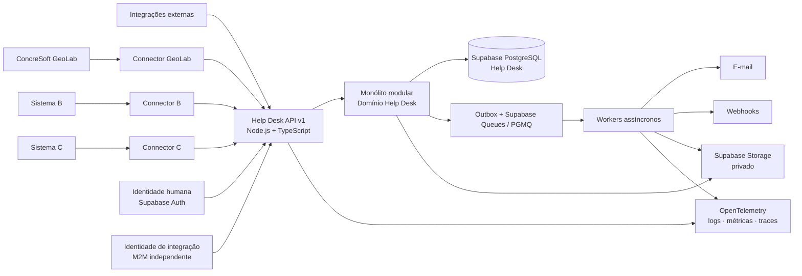
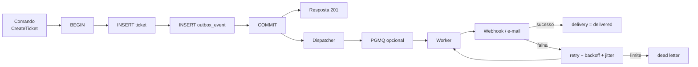
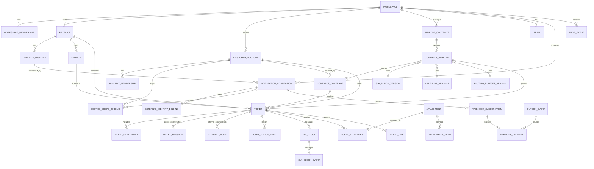
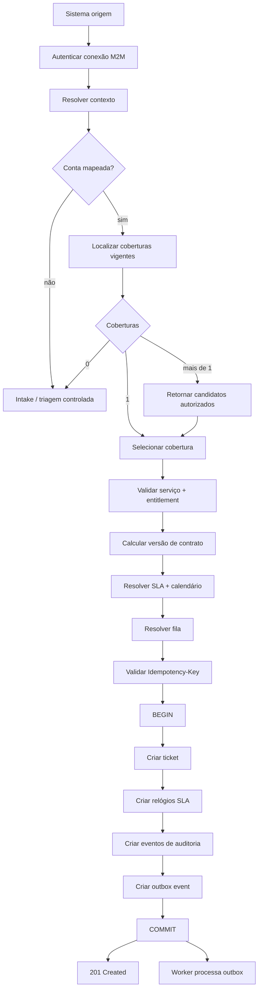
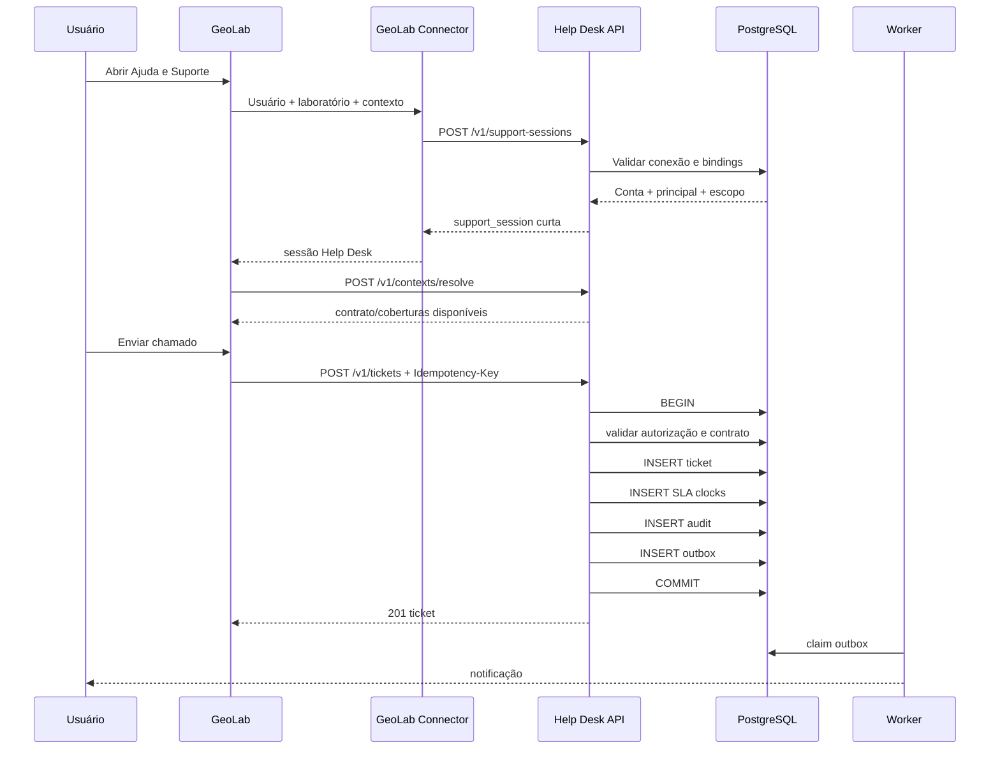
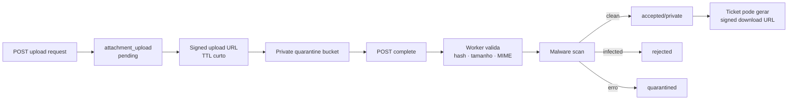

# Deep Research — Help Desk Genérico, Multiproduto e Multicontrato sobre Supabase

## Resumo executivo

A revisão aprofundada confirma a direção geral da especificação anterior — **um Help Desk independente do ConcreSoft GeoLab, com banco próprio e API própria** — mas muda de forma relevante a maneira como eu estruturaria segurança, integrações, contratos, filas, anexos, SLAs e evolução da plataforma.

A recomendação consolidada é construir o Help Desk como um **produto SaaS interno/multiproduto**, inicialmente em **monólito modular com processos assíncronos separados**, usando o projeto Supabase `xaelbntjnvztznnpcvtm` como plataforma de dados. O núcleo deve ser independente dos sistemas atendidos; GeoLab e futuros produtos passam por conectores que funcionam como uma *Anti-Corruption Layer*, traduzindo identidade, conta, contrato e contexto da aplicação externa para o modelo canônico do Help Desk. Esse padrão existe justamente para impedir que modelos e particularidades dos sistemas integrados contaminem o domínio central. citeturn24search1

A decisão arquitetural mais importante é esta:

> **O Help Desk não deve ser um “módulo compartilhado pelos sistemas”; deve ser um produto central que expõe capacidades de suporte a vários sistemas.**

O desenho revisado fica conceitualmente assim:



O banco continua podendo ser único, mas **não recomendo simplesmente colocar `tenant_id` em algumas tabelas e confiar na aplicação**. A pesquisa em segurança multitenant reforça que o isolamento precisa alcançar consultas, relacionamentos, arquivos, caches, filas, exportações e tarefas assíncronas. OWASP também recomenda testar explicitamente a troca de identificadores entre usuários/tenants em todas as operações que recebem referências de objetos. citeturn24search0turn24search7

No Supabase, RLS constitui uma importante segunda barreira, mas deve ser combinada com `GRANT`s adequados e não substitui autorização da API. A documentação atual alerta especificamente sobre tabelas em schemas expostos, chaves que ignoram RLS e funções `SECURITY DEFINER`; por isso, o núcleo do Help Desk deve ficar em **schema não exposto**, e nenhuma `service_role` deve chegar ao navegador ou a um sistema cliente. A documentação oficial do Supabase também recomenda testes automatizados das regras de RLS. citeturn25search0

Para integrações máquina-a-máquina, a arquitetura anterior também precisa ser endurecida. **Não é adequado usar login de usuário nem compartilhar uma Supabase service key com GeoLab ou qualquer outro produto.** O OAuth Server do Supabase não deve ser presumido como um Authorization Server completo para nosso caso M2M; a própria documentação de OAuth do Supabase não oferece `client_credentials` como fluxo suportado. A camada M2M deve, portanto, ser independente da autenticação humana.

Para confiabilidade, proponho agora formalmente uma combinação de:

**transação de domínio → transactional outbox → fila/dispatcher → entrega → ledger de tentativas**.

O padrão transactional outbox resolve o problema de gravar a alteração no banco e tentar publicar uma mensagem em outra infraestrutura como duas operações independentes; AWS também ressalta que duplicações continuam possíveis e consumidores precisam ser idempotentes. citeturn24search2

No caso do Supabase, **PGMQ/Supabase Queues é uma excelente opção inicial**, porque mantém a fila próxima ao PostgreSQL e não obriga a introduzir Redis, RabbitMQ ou Kafka desde o primeiro dia. A fila, entretanto, não substitui a tabela de outbox: elas resolvem responsabilidades diferentes.

Em anexos, a nova proposta exige **bucket privado + quarentena + análise + promoção**, e não upload direto para o “arquivo definitivo”. A documentação do Supabase confirma que buckets privados usam controle de acesso e URLs assinadas de duração limitada; URLs assinadas permanecem válidas até expirarem, independentemente da rotação das chaves de autenticação, o que reforça o uso de TTL curto. O próprio Supabase também separa metadados do Storage dos objetos efetivamente armazenados. Por isso, backup de PostgreSQL e backup de anexos precisam ser tratados separadamente.

Do benchmark de produtos, o principal aprendizado é que **SLA, estado, fila, prioridade e acesso não devem ser representados como uma única regra**. Jira Service Management permite definir separadamente condições de início, pausa e término dos SLAs; Freshdesk distingue primeira resposta, resolução e automações temporais. citeturn25search1turn25search2turn25search13

Minha recomendação final para a primeira versão é:

| Decisão | Recomendação |
|---|---|
| Arquitetura | **Monólito modular + workers** |
| Backend | **Node.js + TypeScript + Fastify** |
| Alternativa de backend | NestJS; ASP.NET Core é forte alternativa se a equipe preferir .NET |
| Banco | **Supabase PostgreSQL exclusivo do Help Desk** |
| Isolamento | `workspace_id` + FKs compostas + autorização de aplicação + RLS |
| Schema | Domínio em schema privado/não exposto |
| Auth humana | Supabase Auth |
| Auth M2M | Credencial própria por conexão, tokens curtos e escopos; não reutilizar login humano |
| API | REST `/v1`, OpenAPI, erros RFC 9457, cursor pagination |
| Concorrência | `ETag`/`If-Match` em mutações relevantes |
| Criação idempotente | `Idempotency-Key` + hash da requisição + resposta persistida |
| Eventos | Transactional outbox |
| Fila inicial | Supabase Queues/PGMQ |
| Webhooks | CloudEvents-like envelope + assinatura + retry + delivery ledger |
| Anexos | Storage privado, quarantine → scan → clean/rejected |
| Busca | PostgreSQL Full Text Search inicialmente |
| Observabilidade | OpenTelemetry + logs estruturados |
| Testes | Vitest + pgTAP/RLS + Playwright + testes OpenAPI + carga e segurança |
| GeoLab | Conector independente; nunca acesso direto ao banco Help Desk |
| Segundo consumidor | Obrigatório antes de considerar a arquitetura “genérica” |
| IA | Evolução posterior; não faz parte do caminho crítico de abertura de chamado |

A pesquisa não encontrou justificativa técnica para começar com microsserviços. Os padrões de arquitetura de cloud mostram que microsserviços adicionam comunicação de rede, consistência eventual, coordenação de transações e observabilidade distribuída; essas dificuldades só se justificam quando há necessidade real de escalabilidade, isolamento, compliance ou ownership organizacional. citeturn24search4turn24search11turn24search12

## O que a pesquisa mudou na especificação

A v3 estava correta ao separar Help Desk e GeoLab, mas a pesquisa mostra que algumas fronteiras precisam ficar ainda mais explícitas.

**A primeira mudança é de “tenant” para “workspace + conta + contrato + produto”.** Uma empresa pode usar vários produtos; um produto pode conter várias contas; uma conta pode ter múltiplos contratos; e um contrato pode cobrir vários serviços. Esses conceitos não podem ser resumidos em uma coluna `tenant_id`.

O modelo revisado será:

```text
Workspace
   ├── membros da operação de suporte
   ├── produtos
   ├── contas de clientes
   ├── contratos
   ├── equipes
   └── integrações

Produto
   └── Instâncias
          └── Conexões com sistemas

Conta
   ├── membros
   ├── referências externas
   └── contratos elegíveis

Contrato
   └── Versão publicada
          ├── coberturas
          ├── SLA
          ├── calendário
          └── regras de roteamento

Ticket
   └── snapshots das regras aplicadas
```

**A segunda mudança é que o contrato deve ser versionado.** Alterar hoje o SLA de um contrato não deve reescrever semanticamente um chamado aberto ontem. Portanto, o ticket deve guardar referências a versões imutáveis de contrato, cobertura, política de SLA, calendário e conjunto de regras utilizados na classificação.

**A terceira mudança é separar “pode criar” de “pode acessar”.** Produtos maduros também tratam permissões de portal e regras de operação como assuntos distintos. Jira Service Management possui configurações específicas para acesso ao portal e restrições de request types; isso reforça a necessidade de não interpretar elegibilidade para criar uma solicitação como autorização permanente sobre qualquer recurso relacionado. citeturn25search4turn25search10turn25search25

**A quarta mudança é abandonar RBAC puro para autorização de recursos.** Ter a função `cliente`, `agente` ou `admin` não responde sozinho perguntas como “este cliente pode visualizar este chamado deste contrato?”. O desenho passa a combinar:

```text
papel
+ vínculo com workspace
+ vínculo com conta
+ vínculo com contrato
+ vínculo com ticket
+ capacidade solicitada
+ estado/configuração do recurso
= decisão de autorização
```

Isso mantém RBAC para capacidades amplas, mas adiciona relacionamento e atributos para autorização contextual.

**A quinta mudança é estruturalmente separar mensagens públicas e notas internas.** Não considero mais suficiente ter uma tabela `messages` com `is_internal = true`. A implementação recomendada usa:

```text
ticket_messages
internal_notes
```

em tabelas separadas. Isso reduz a probabilidade de uma consulta, serializer, webhook ou exportação esquecer um filtro e enviar conteúdo interno ao cliente.

**A sexta mudança é diferenciar estado de atendimento e relógio de SLA.** Esperar pelo cliente pode pausar determinados relógios, mas isso não significa que `status = waiting_customer` deva implicitamente conter toda a lógica contratual. Jira Service Management modela condições específicas de início, pausa e fim de SLA; Freshdesk também diferencia eventos como primeira resposta e resolução. citeturn25search1turn25search2turn25search13

Eu usaria estados internos:

```text
new
triage
open
waiting_customer
waiting_internal
waiting_third_party
resolved
closed
cancelled
```

e uma projeção menor para clientes:

```text
received
in_progress
waiting_for_you
resolved
closed
```

Cada SLA teria relógios independentes, por exemplo:

```text
first_response
next_response
resolution
```

**A sétima mudança é tratar regras como configuração compilável e simulável.** Freshdesk documenta regras processadas sequencialmente e situações em que a ordem é relevante. Em nosso sistema, eu evitaria dependência silenciosa da posição visual de uma regra: cada regra terá prioridade explícita, versão, validação de conflitos e uma API de simulação antes da publicação. citeturn25search5turn25search8

Exemplo:

```json
{
  "account_id": "acc_123",
  "product_id": "prd_geolab",
  "service_code": "DOCUMENT_PROCESSING",
  "severity": "high"
}
```

Resultado de simulação:

```json
{
  "contract": "CTR-2026-018",
  "contract_version": 3,
  "coverage": "GEO-DOCS",
  "sla": {
    "first_response_minutes": 60,
    "resolution_minutes": 480
  },
  "queue": "geolab-n2",
  "matched_rules": [
    "contract-coverage-021",
    "routing-004"
  ]
}
```

Assim, uma alteração administrativa pode ser testada contra casos conhecidos antes de se tornar ativa.

## Benchmark de produtos, repositórios e comunidades

O objetivo da pesquisa não foi escolher um projeto existente para copiar. Foi identificar padrões que já sobreviveram a uso real.

Entre os produtos comerciais, **Jira Service Management** oferece boas referências de desenho para request types, workflows, permissões e SLAs configuráveis; seus SLAs permitem condições explícitas de início, pausa e término. citeturn25search1turn25search13turn25search19

**Freshdesk** é particularmente útil como referência para políticas de SLA, automação e primeira resposta. A documentação atual diferencia primeira resposta de respostas automatizadas e possui automações temporais, reforçando que métricas devem registrar autoria e natureza da interação, e não simplesmente considerar qualquer mensagem como “resposta”. citeturn25search2turn25search8

Isso sugere um campo importante:

```text
message.actor_type
  HUMAN_AGENT
  CUSTOMER
  AUTOMATION
  INTEGRATION
  SYSTEM
```

Uma mensagem automática não deverá cumprir automaticamente um SLA de primeira resposta humana.

**Zendesk** permanece uma referência útil para webhooks, auditoria, campos de ticket e ecossistema de integração; **Intercom** oferece boas referências para conversas/tickets, atendimento omnichannel e experiência do agente. Para o nosso projeto, porém, os modelos de contrato e isolamento precisam ser mais fortes do que aqueles normalmente apresentados na camada de produto desses sistemas.

A análise open-source foi especialmente útil porque permite observar maturidade de comunidades e bases de código reais.

| Projeto | Maturidade observável em 15/09/2026 | Stack principal | Licença indicada pelo GitHub | O que vale estudar | Usaria como base? |
|---|---|---|---|---|---|
| **Chatwoot** | ~36,8 mil estrelas, ~8,9 mil forks, atividade no mesmo dia | Ruby/Rails + frontend web | API do GitHub retornou licença não normalizada/`NOASSERTION`; requer revisão jurídica antes de reutilizar código | UX de conversas, inbox, canais, widgets, webhooks | **Não como base**, mas excelente referência funcional. fileciteturn7file0L2-L2 |
| **GLPI** | ~6,3 mil estrelas, ~1,8 mil forks, atividade no mesmo dia | PHP | GPL-3.0 | ITSM, SLAs, tickets, ativos, processos corporativos | Não; escopo ITSM muito maior que o necessário. fileciteturn10file0L2-L2 |
| **Zammad** | ~5,9 mil estrelas, ~1 mil forks, atividade no mesmo dia | Ruby/Rails | AGPL-3.0 | tickets, grupos, SLA, trigger, API, KB, canais | Não diretamente; **forte referência de domínio**. fileciteturn1file0L2-L2 |
| **FreeScout** | ~4,5 mil estrelas, ~716 forks, atividade no mesmo dia | PHP/Laravel | AGPL-3.0 | mailbox compartilhada, operação simples, e-mail | Não; bom benchmark para UX simples. fileciteturn8file0L2-L2 |
| **osTicket** | ~3,9 mil estrelas, ~1,8 mil forks; último push identificado em junho/2026 | PHP | GPL-2.0 | filtros, departamentos, SLA, fluxo tradicional | Não; arquitetura e stack não trazem vantagem para este projeto. fileciteturn9file0L2-L2 |
| **Frappe Helpdesk** | ~3,4 mil estrelas, ~939 forks, atividade em setembro/2026 | Vue/Python/Frappe | AGPL-3.0 | UI moderna, SLA, equipe, tickets | Estudar frontend e UX; evitar dependência do Frappe. fileciteturn11file0L2-L2 |

A conclusão do inventário é importante: **não recomendo fazer fork de nenhum desses produtos** para construir o Help Desk proposto. Eles resolvem problemas adjacentes, mas incorporar contrato multiproduto, isolamento específico, integração com sistemas existentes e Supabase dentro dessas arquiteturas provavelmente produziria mais acoplamento do que economia.

Eles devem ser tratados como **reference implementations**.

Para o backend próprio, duas alternativas Node.js se destacam. O Fastify apresenta uma base madura e ativa, licença MIT e aproximadamente 37 mil estrelas no levantamento; NestJS possui ecossistema ainda maior, TypeScript nativo e aproximadamente 76 mil estrelas. fileciteturn13file0L2-L2 fileciteturn15file0L2-L2

Eu escolheria:

| Opção | Pontos fortes | Custos | Recomendação |
|---|---|---|---|
| **Fastify + TypeScript** | Baixo overhead, schemas explícitos, boa adequação API-first, pouca “mágica” | Exige disciplina arquitetural da equipe | **Preferida** |
| NestJS + TypeScript | Módulos, DI, convenções fortes, bom para equipes grandes | Mais abstração/framework | Excelente alternativa |
| ASP.NET Core | Excelente runtime, tipos, auth e tooling; familiar se equipe GeoLab for .NET | Novo ecossistema para frontend/backend TS | Alternativa muito forte |
| Go | Simples em produção, concorrência e eficiência | Mais esforço de modelagem e validação de domínio | Bom para workers futuros |
| Supabase Edge Functions/Deno | Excelente para callbacks e pequenas funções próximas da plataforma | Não seria minha escolha para todo o domínio e processamento de longa duração | Uso complementar |

O projeto **PGMQ**, que sustenta a ideia de fila sobre PostgreSQL, tinha cerca de 5,3 mil estrelas e atividade recente no levantamento, com licença PostgreSQL. fileciteturn17file0L2-L2

Isso torna a combinação PostgreSQL + PGMQ bastante atraente para a primeira geração, sem introduzir Redis apenas para ter uma fila.

**Comunidades também produziram sinais operacionais importantes.** Fóruns de produtos como Zammad, Frappe, GLPI e Chatwoot, além de Stack Overflow e comunidades de suporte, repetem problemas menos “arquiteturais”, mas igualmente importantes: clientes preferem canais simples; e-mail continua relevante; respostas como “obrigado” podem reabrir tickets indevidamente; auto-replies podem criar loops; equipes pequenas rejeitam processos excessivamente complexos; e anexos, threading de e-mail e permissões geram grande parte das situações difíceis.

Esses relatos de comunidades devem ser tratados como evidência anedótica, não como especificação técnica. Ainda assim, eles levam a boas regras de produto:

| Insight operacional | Consequência para o nosso Help Desk |
|---|---|
| Cliente não quer preencher formulário enorme | Formulário inicial pequeno; contexto técnico coletado automaticamente. |
| “Obrigado” não deveria destruir métricas | Não reabrir automaticamente apenas por qualquer mensagem após resolução. |
| E-mail gera loops de auto-resposta | `Message-ID`, `In-Reply-To`, detecção de auto-reply e idempotência quando e-mail entrar no roadmap. |
| Agentes precisam conversar sem expor tudo | Nota interna estruturalmente separada. |
| Métricas podem incentivar comportamento ruim | Medir primeira resposta, resolução, reabertura, espera e satisfação separadamente. |
| Portal é melhor para contexto; e-mail é mais simples | Portal/API primeiro, e-mail como canal adicional, ambos chegando ao mesmo ticket. |

## Decisões de arquitetura e trade-offs

A comparação completa leva à seguinte recomendação.

| Tema | Alternativa | Vantagem | Desvantagem | Decisão |
|---|---|---|---|---|
| Arquitetura | Monólito modular | Transação local, menor custo operacional, debugging simples | Exige disciplina de módulos | **Adotar** |
| Arquitetura | Microsserviços | Escala/ownership independentes | Rede, consistência, observabilidade e deployment distribuídos | Não inicialmente |
| Dados | Um PostgreSQL Help Desk | ACID, joins, transação única, RLS | Requer excelente isolamento lógico | **Adotar** |
| Dados | Banco por cliente | Isolamento físico | Explosão operacional e migrations | Apenas exceções regulatórias futuras |
| Dados | Database-per-service | Independência | Transações distribuídas | Não agora |
| Humano | Supabase Auth | Integrado, sessões e identidade | Não resolve autorização de domínio | **Adotar para pessoas** |
| M2M | Compartilhar `service_role` | Fácil | Privilégio extremo e blast radius enorme | **Proibido** |
| M2M | API key longa | Simples | Roubo equivale a bearer permanente | Apenas transição controlada |
| M2M | Token curto e credencial por conexão | Rotação, escopos, revogação | Mais implementação | **Adotar** |
| Outbox | HTTP direto no request | Fácil | Dual-write / falhas difíceis | Não |
| Outbox | DB outbox + polling | Muito confiável e simples | Polling | **Adotar inicialmente** |
| Outbox | Outbox + PGMQ | Boa durabilidade e desacoplamento | Mais componente lógico | Evolução natural |
| Outbox | CDC/Debezium | Alta escala e integração com brokers | Grande custo operacional | Só quando necessário |
| Fila | PGMQ | Mesmo PostgreSQL, menos infra | Acoplado ao banco | **Preferida** |
| Fila | BullMQ/Redis | Ecossistema Node maduro | Redis adicional | Só se houver necessidade específica |
| Fila | Kafka | Excelente streaming | Overkill para estágio inicial | Não |
| Anexos | Bucket público | Simples | Incompatível com confidencialidade | **Proibido** |
| Anexos | Bucket privado | RLS/signed URLs | Requer lifecycle seguro | **Adotar** |
| Backup | Somente backup DB | Simples | Não é recuperação completa de anexos | Insuficiente |
| Backup | DB + objetos + configuração + restore drill | Recuperação completa | Mais processo | **Adotar** |
| Pesquisa | Elasticsearch imediato | Escala e ranking | Novo cluster/serviço | Não |
| Pesquisa | PostgreSQL FTS | Baixa complexidade | Limites em escala extrema | **Adotar primeiro** |

A escolha do monólito modular não impede futura decomposição. Pelo contrário, o objetivo é criar módulos suficientemente isolados para que módulos com requisitos muito diferentes possam ser extraídos posteriormente. O custo de microsserviços inclui transações distribuídas, consistência eventual, retries e observabilidade mais complexa; padrões de saga existem justamente para tratar parte dessa complexidade. citeturn24search4turn24search11turn24search12

**Os módulos internos que eu criaria desde o início são:**

```text
identity
tenancy
catalog
contracts
entitlements
tickets
conversations
sla
routing
attachments
integrations
webhooks
notifications
audit
reporting
knowledge       [P1]
automation      [P1]
```

Cada módulo deve ter:

```text
domain/
application/
infrastructure/
api/
```

e não acessar indiscriminadamente tabelas de outro módulo.

**No Supabase, eu recomendo separar schemas:**

```text
auth                Supabase
storage             Supabase
pgmq                Supabase Queues

helpdesk_core       domínio
helpdesk_audit      auditoria
helpdesk_integration integração/outbox
helpdesk_reporting  views/materializações controladas
```

O `public` não deve ser o local padrão do modelo de negócio.

A documentação atual do Supabase enfatiza que RLS e grants funcionam em conjunto e alerta que uma função `SECURITY DEFINER` em schema exposto pode ser invocada com privilégios do criador. Também recomenda `search_path = ''` para funções desse tipo. Essas recomendações precisam virar *lint/checklist* de migrations, e não depender de memória de quem estiver escrevendo SQL. citeturn25search0

Para conexões PostgreSQL reutilizadas pelo backend, qualquer contexto colocado na sessão deve ser transacional. Um padrão aceitável é:

```sql
begin;

set local app.workspace_id = '...';
set local app.principal_id = '...';

-- operações

commit;
```

Nunca:

```sql
set app.workspace_id = '...';
```

numa conexão reaproveitada por pool, porque contexto de um request não pode permanecer disponível ao próximo.

**Idempotência ganha especificação formal.**

Para:

```http
POST /v1/tickets
Idempotency-Key: geo-205-documento-88412
```

persistir:

```text
principal
operation
key
request_hash
status
response_body
resource_id
created_at
expires_at
```

Regra:

```text
mesma key + mesmo hash
→ devolver a resposta original

mesma key + payload diferente
→ HTTP 409 idempotency_conflict
```

Essa garantia precisa de `UNIQUE` no banco; um `Map` em memória ou cache sozinho não resolve corrida entre instâncias.

Para updates concorrentes:

```http
GET /v1/tickets/tck_123
ETag: "17"

PATCH /v1/tickets/tck_123
If-Match: "17"
```

Se outra operação já atualizou o recurso:

```http
412 Precondition Failed
```

Isso evita agentes sobrescrevendo alterações uns dos outros.

**Outbox revisado:**



A razão é exatamente o problema de *dual write*: gravar estado no banco e publicar externamente não constitui uma operação atômica. Transactional outbox é o padrão indicado para preservar a intenção de publicação junto da transação; consumidores continuam precisando ser idempotentes porque mensagens podem ser repetidas. citeturn24search2

**Não prometerei “exactly once” para integrações externas.**

Mesmo que uma fila ofereça garantias fortes de consumo, existe sempre uma janela como:

```text
worker envia webhook
↓
destino processa
↓
rede cai antes da confirmação
↓
worker não sabe se processou
```

A resposta arquitetural correta é entrega **at-least-once + consumidor idempotente**, não marketing de “exactly once”.

## Arquitetura técnica revisada

O modelo ER consolidado fica assim:



**Tabelas P0 sugeridas:**

| Domínio | Tabelas |
|---|---|
| Tenancy | `workspaces`, `workspace_memberships`, `customer_accounts`, `account_memberships` |
| Catálogo | `products`, `product_instances`, `services`, `teams` |
| Integração | `integration_connections`, `integration_credentials`, `external_identity_bindings`, `source_scope_bindings` |
| Contratos | `support_contracts`, `contract_versions`, `contract_coverages` |
| Regras | `business_calendars`, `calendar_versions`, `sla_policies`, `sla_policy_versions`, `routing_rulesets`, `routing_ruleset_versions` |
| Tickets | `intake_requests`, `tickets`, `ticket_participants`, `ticket_messages`, `internal_notes`, `ticket_status_events`, `ticket_links` |
| SLA | `sla_clocks`, `sla_clock_events` |
| Arquivos | `attachment_uploads`, `attachments`, `attachment_scans`, `ticket_attachments` |
| Confiabilidade | `api_idempotency_keys`, `outbox_events`, `webhook_subscriptions`, `webhook_deliveries`, `sync_batches` |
| Segurança | `principal_grants`, `audit_events` |

A regra estrutural será:

```text
Toda tabela pertencente ao domínio de um workspace
deve possuir workspace_id
```

e relações sensíveis devem usar FKs compostas quando possível:

```sql
foreign key (workspace_id, account_id)
references customer_accounts(workspace_id, id)
```

Isso impede inclusive que bugs de aplicação consigam relacionar um ticket de `workspace A` a uma conta de `workspace B`.

**Fluxo completo de criação:**



A resolução não será autorização permanente. A API deve revalidar a cobertura dentro da operação de criação, pois um contrato pode ter expirado ou sido suspenso entre `resolve` e `create`.

**Integração GeoLab / qualquer outro sistema:**



O segredo M2M permanece no backend do GeoLab. **Nunca deve ser entregue ao navegador.**

Para anexos:



Essa proposta segue a orientação de não tratar upload como simples extensão do formulário. OWASP recomenda controles como allowlist, validação de tipo/conteúdo, nome controlado pelo sistema, limites, autorização e análise do arquivo quando aplicável. citeturn24search3turn24search7

**API v4 proposta:**

| Método | Endpoint | Finalidade |
|---|---|---|
| `GET` | `/v1/capabilities` | Negociação de capacidades |
| `POST` | `/v1/support-sessions` | Sessão curta para experiência integrada |
| `POST` | `/v1/contexts/resolve` | Resolver conta/contrato/coberturas |
| `GET` | `/v1/contracts` | Contratos visíveis |
| `GET` | `/v1/contracts/{id}` | Contrato |
| `GET` | `/v1/contracts/{id}/coverages` | Coberturas |
| `GET` | `/v1/services` | Serviços elegíveis |
| `POST` | `/v1/tickets` | Criar ticket |
| `GET` | `/v1/tickets` | Listar |
| `GET` | `/v1/tickets/{id}` | Consultar |
| `PATCH` | `/v1/tickets/{id}` | Alterações controladas |
| `POST` | `/v1/tickets/{id}/transitions` | Estado |
| `GET` | `/v1/tickets/{id}/timeline` | Timeline autorizada |
| `GET/POST` | `/v1/tickets/{id}/messages` | Conversa pública |
| `POST` | `/v1/tickets/{id}/participants` | Participantes |
| `POST` | `/v1/tickets/{id}/assignments` | Fila/responsável |
| `POST` | `/v1/tickets/{id}/merge` | Mesclar duplicados com validação forte |
| `POST` | `/v1/intakes` | Solicitação sem cobertura resolvida |
| `POST` | `/v1/attachment-uploads` | Iniciar upload |
| `POST` | `/v1/attachment-uploads/{id}/complete` | Finalizar upload |
| `GET` | `/v1/attachments/{id}` | Metadata |
| `POST` | `/v1/attachments/{id}/download-url` | Download autorizado |
| `POST` | `/v1/sync/batches` | Sincronização controlada |
| `GET` | `/v1/operations/{id}` | Operação assíncrona |
| `GET/POST` | `/v1/webhook-subscriptions` | Subscriptions |
| `PATCH` | `/v1/webhook-subscriptions/{id}` | Atualização |
| `POST` | `/v1/webhook-subscriptions/{id}/rotate-secret` | Rotação |
| `GET` | `/v1/webhook-deliveries` | Entregas |
| `GET` | `/v1/webhook-deliveries/{id}` | Diagnóstico |
| `POST` | `/v1/webhook-deliveries/{id}/redeliver` | Redelivery |
| `POST` | `/v1/routing/simulations` | Simular regras antes de publicar |
| `GET` | `/v1/audit-events` | Auditoria autorizada |

Os erros devem adotar `application/problem+json` no estilo RFC 9457, por exemplo:

```json
{
  "type": "https://errors.helpdesk.example/idempotency-conflict",
  "title": "Idempotency key conflict",
  "status": 409,
  "detail": "A chave já foi usada com um payload diferente.",
  "code": "idempotency_conflict",
  "request_id": "req_01K..."
}
```

Criação:

```http
POST /v1/tickets
Authorization: Bearer <token>
Idempotency-Key: 5cfed915-04ac-4791-a174-e7f231cadf38
Content-Type: application/json
```

```json
{
  "context_resolution_id": "res_01K...",
  "coverage_id": "cov_01K...",
  "service_code": "DOCUMENT_PROCESSING",
  "subject": "Falha ao gerar relatório",
  "description": "O relatório não foi concluído.",
  "source": {
    "product": "geolab",
    "environment": "production",
    "external_context": {
      "module": "documents",
      "route": "/documents/88412",
      "diagnostic_id": "diag_8721"
    }
  }
}
```

Resposta:

```json
{
  "id": "tck_01K...",
  "number": "HD-2026-000184",
  "status": "new",
  "customer_status": "received",
  "account": {
    "id": "acc_01K..."
  },
  "contract": {
    "id": "ctr_01K...",
    "version": 3
  },
  "sla": {
    "first_response_due_at": "2026-09-15T19:30:00Z",
    "resolution_due_at": "2026-09-16T02:30:00Z"
  },
  "created_at": "2026-09-15T18:30:00Z",
  "version": 1
}
```

Para webhooks, eu adotaria envelope compatível conceitualmente com CloudEvents:

```json
{
  "specversion": "1.0",
  "id": "evt_01K...",
  "source": "helpdesk/workspaces/ws_01K",
  "type": "com.helpdesk.ticket.status_changed.v1",
  "subject": "tickets/tck_01K",
  "time": "2026-09-15T18:41:27Z",
  "datacontenttype": "application/json",
  "data": {
    "ticket_id": "tck_01K...",
    "from": "open",
    "to": "waiting_customer",
    "version": 8
  }
}
```

A assinatura deve usar algoritmo moderno, identificador da entrega, timestamp e corpo bruto. Também precisam existir proteção contra replay, rotação de segredo e defesa de SSRF na configuração do destino.

## Requisitos, homologação e roadmap

Após a pesquisa, eu elevaria os seguintes requisitos a **P0 — obrigatórios antes de produção**:

| ID | Requisito | Critério de aceite resumido |
|---|---|---|
| SEC-001 | Isolamento por workspace | Tentativas cruzadas por ID não retornam dados de outro workspace. |
| SEC-002 | Autorização por recurso | Toda operação com `ticket_id`, `attachment_id`, `contract_id` etc. executa autorização de objeto. |
| SEC-003 | RLS defense-in-depth | Suite testa allow/deny para identidades de workspaces diferentes. |
| SEC-004 | Schema de domínio não exposto | Data API não oferece acesso direto às tabelas centrais. |
| SEC-005 | Nenhuma service key em cliente | Build, logs e frontend não contêm chave privilegiada. |
| SEC-006 | MFA administrativo | Operações administrativas sensíveis exigem conta protegida conforme política aprovada. |
| SEC-007 | Auditoria | Mudança sensível registra ator, recurso, ação, instante e request/trace ID. |
| TEN-001 | Workspace explícito | Todas as entidades de domínio são vinculadas a workspace. |
| TEN-002 | Integridade cruzada | FKs/constraints impedem relações entre workspaces. |
| IAM-001 | Auth humana separada de M2M | Nenhum conector autentica simulando usuário final. |
| IAM-002 | Credencial por conexão | Revogar Sistema A não afeta Sistema B. |
| IAM-003 | Token curto/scoped | Token inválido, expirado ou sem scope é rejeitado. |
| IAM-004 | Embedded support session | Frontend recebe sessão temporária, nunca segredo M2M. |
| CON-001 | Contrato versionado | Alteração publicada cria versão, sem modificar versão usada por ticket existente. |
| CON-002 | Cobertura explícita | Conta/produto/serviço devem corresponder à cobertura. |
| CON-003 | Ambiguidade | Mais de uma cobertura gera escolha/resultado explícito, nunca primeira correspondência oculta. |
| CON-004 | Contrato sem cobertura | Sistema cria intake/triagem, não SLA contratual fictício. |
| TKT-001 | Criação idempotente | Retry idêntico não cria ticket adicional. |
| TKT-002 | Conflito idempotente | Mesma key com payload diferente retorna `409`. |
| TKT-003 | Concorrência otimista | Update com versão antiga falha em vez de sobrescrever. |
| TKT-004 | Conversa pública isolada | Integrações de cliente nunca recebem `internal_notes`. |
| TKT-005 | Histórico | Transições relevantes são auditáveis. |
| SLA-001 | Política versionada | Ticket mantém política aplicada no momento definido pelo negócio. |
| SLA-002 | Relógios independentes | First response e resolution possuem clocks separados. |
| SLA-003 | Calendário | Feriados/fuso/horários são reproduzíveis. |
| SLA-004 | Pausa explícita | Pausa é evento do clock, não inferência irreversível a partir do status. |
| SLA-005 | Automação ≠ resposta humana | Resposta automática não satisfaz SLA humano salvo configuração explícita. |
| ROU-001 | Regras versionadas | Publicação cria versão imutável. |
| ROU-002 | Simulação | Admin pode testar payload contra nova regra antes de ativar. |
| ROU-003 | Conflito | Regras de mesma precedência conflitantes são sinalizadas. |
| ATT-001 | Storage privado | Não existe URL pública permanente de anexo. |
| ATT-002 | Quarentena | Arquivo novo não é disponível antes de validação. |
| ATT-003 | Conteúdo validado | MIME, tamanho e hash são verificados. |
| ATT-004 | Malware | Arquivo rejeitado por scanner não pode ser baixado pelo usuário. |
| ATT-005 | URL curta | Download só produz URL temporária após autorização. |
| REL-001 | Transactional outbox | Ticket/evento são confirmados na mesma transação. |
| REL-002 | Retry | Falhas transitórias usam backoff e jitter. |
| REL-003 | Delivery ledger | Toda tentativa externa é registrada. |
| REL-004 | Dead letter | Falhas permanentes ficam operacionalmente visíveis. |
| REL-005 | Worker idempotente | Crash/reprocessamento não duplica efeitos controlados. |
| API-001 | OpenAPI versionada | CI falha em contrato inválido. |
| API-002 | Erro padronizado | Erros da API possuem formato único. |
| API-003 | Paginação | Listagens grandes usam cursor, não offset ilimitado. |
| API-004 | Rate limiting | Limites consideram conexão/workspace, evitando noisy neighbor. |
| API-005 | Correlação | Cada request, job e webhook pode ser correlacionado ponta a ponta. |
| OPS-001 | Observabilidade | Métricas, logs e traces cobrem API e workers. |
| OPS-002 | Redação | Segredos e corpo sensível não são registrados por padrão. |
| OPS-003 | Restore DB | Restauração do banco é ensaiada. |
| OPS-004 | Restore Storage | Restauração de objetos é ensaiada separadamente. |
| OPS-005 | Runbooks | Incidentes de fila, webhook, Storage e auth possuem procedimentos documentados. |

**P1**, depois do núcleo estabilizado:

```text
e-mail bidirecional
base de conhecimento
respostas salvas
macros
automação configurável
CSAT
dashboards operacionais
busca full-text
merge avançado
parent/child tickets
integração de calendário
exportação regulada
```

**P2**:

```text
IA para classificação
resumo automático
RAG sobre conhecimento
sugestão de resposta
WhatsApp
voice
sentiment
automação preditiva
```

IA não deve decidir autorização, contratos ou mudanças irreversíveis sozinha.

A suíte de homologação deve ser construída em torno de ataques e falhas, não somente do caminho feliz. OWASP recomenda explicitamente criar usuários com escopos diferentes e trocar referências de recursos entre eles para verificar IDOR/BOLA. citeturn24search0turn24search9

Os cenários que considero **bloqueadores de produção** são:

1. Usuário de A substitui `ticket_id` por ticket de B: nenhum dado de B é retornado.
2. Mesmo teste para mensagem, anexo, participante, contrato, exportação e busca.
3. Agente com acesso à fila mas sem acesso à conta não obtém histórico indevido.
4. Contrato A + conta B é rejeitado por constraint/autorização.
5. `Idempotency-Key` concorrente produz exatamente um ticket.
6. Mesma key com payload alterado retorna conflito.
7. Worker cai depois do efeito externo e antes do `ack`: retry não produz corrupção.
8. Evento de outbox não existe quando transação do ticket sofre rollback.
9. Webhook duplicado pode ser processado de forma idempotente pelo consumidor de referência.
10. Webhook para `127.0.0.1`, metadata endpoint, IP privado ou DNS malicioso é bloqueado.
11. Segredo de webhook antigo deixa de ser aceito após janela de rotação definida.
12. Upload infectado permanece inacessível.
13. Upload com MIME/extensão divergentes é tratado conforme política.
14. URL de download expirada não funciona.
15. Usuário autorizado perde acesso e não consegue gerar nova URL.
16. Restauração apenas do DB evidencia ausência dos objetos; restauração completa recupera ambos.
17. SLA atravessando feriado, fim de semana e mudança de timezone produz resultado conhecido.
18. Mudança de SLA contratual não recalcula silenciosamente tickets históricos.
19. Resposta automatizada não satisfaz SLA de resposta humana.
20. “Obrigado” após resolução segue política de reopen, sem alteração acidental de métricas.
21. Regra de roteamento conflitante é rejeitada ou sinalizada antes da publicação.
22. Workspace de grande volume não esgota workers de todos os demais.
23. Log não contém bearer token, segredo M2M ou URL assinada completa.
24. Backup é restaurado em ambiente de recuperação e comparado com manifesto.
25. GeoLab passa na homologação.
26. **Um segundo sistema tecnicamente diferente do GeoLab passa na mesma API sem alteração estrutural das tabelas centrais.**

O cenário 26 é especialmente importante. Sem ele, ainda não teremos provado que construímos um Help Desk genérico.

O roadmap recomendado:

| Pacote | Conteúdo | Esforço relativo | Risco |
|---|---|---:|---|
| **Fundação** | ADRs, threat model, repositório, environments, migrations, CI | M | Médio |
| **Tenancy e segurança** | workspace, accounts, grants, RLS, testes de isolamento | L | **Alto** |
| **Identidade** | Supabase Auth humano, MFA policy, M2M, support sessions | L | **Alto** |
| **Catálogo e contratos** | products, services, contract/version/coverage | L | **Alto** |
| **Tickets** | tickets, participants, public messages, notes, timeline | L | Médio |
| **SLA e calendário** | clocks/eventos, políticas versionadas, calendários | L | **Alto** |
| **Routing** | filas, equipes, rulesets, simulation | M/L | Alto |
| **Confiabilidade** | idempotência, outbox, PGMQ, retry, DLQ | L | **Alto** |
| **Webhooks** | subscriptions, signing, delivery ledger, SSRF controls | M/L | **Alto** |
| **Attachments** | quarantine, signed upload, scan, promotion, restore | L | **Alto** |
| **Interfaces** | portal, agent console, administração | L | Médio |
| **Observabilidade/DR** | OTel, alertas, dashboards, runbooks, backups | M/L | Alto |
| **Security hardening** | BOLA suite, fuzz/API, dependency, DAST, load | L | **Alto** |
| **GeoLab pilot** | conector + embedded support session | M | Alto |
| **Genericity proof** | segundo produto não-GeoLab | M | **Alto** |
| **Canais P1** | e-mail/knowledge/CSAT/automations | L | Médio |

Não recomendo cronograma baseado apenas nesses tamanhos. Risco de autorização, contratos e SLA depende diretamente das regras de negócio que ainda serão formalizadas.

## Artefatos e fontes prioritárias

A especificação OpenAPI revisada deve usar OpenAPI 3.1.x no primeiro ciclo de implementação, mesmo existindo versões mais novas da especificação, porque compatibilidade com geradores, linters e clientes deve pesar mais que adotar imediatamente a revisão mais recente. O contrato precisa incluir `Idempotency-Key`, `If-Match`, `application/problem+json`, paginação por cursor, rate limiting, request IDs e exemplos como os apresentados neste relatório.

Estrutura recomendada do artefato:

```yaml
openapi: 3.1.1
info:
  title: Generic Help Desk API
  version: 4.0.0
  description: >
    API multi-product and multi-contract for the independent Help Desk platform.

servers:
  - url: https://api.helpdesk.example.com/v1
    description: Example only - not deployed

security:
  - bearerAuth: []

paths:
  /capabilities:
    get:
      operationId: getCapabilities

  /support-sessions:
    post:
      operationId: createSupportSession

  /contexts/resolve:
    post:
      operationId: resolveSupportContext

  /contracts:
    get:
      operationId: listContracts

  /contracts/{contract_id}/coverages:
    get:
      operationId: listContractCoverages

  /services:
    get:
      operationId: listServices

  /tickets:
    get:
      operationId: listTickets
    post:
      operationId: createTicket
      parameters:
        - $ref: '#/components/parameters/IdempotencyKey'

  /tickets/{ticket_id}:
    get:
      operationId: getTicket
    patch:
      operationId: updateTicket
      parameters:
        - $ref: '#/components/parameters/IfMatch'

  /tickets/{ticket_id}/transitions:
    post:
      operationId: transitionTicket
      parameters:
        - $ref: '#/components/parameters/IdempotencyKey'
        - $ref: '#/components/parameters/IfMatch'

  /tickets/{ticket_id}/messages:
    get:
      operationId: listPublicMessages
    post:
      operationId: createPublicMessage
      parameters:
        - $ref: '#/components/parameters/IdempotencyKey'

  /tickets/{ticket_id}/timeline:
    get:
      operationId: getTicketTimeline

  /attachment-uploads:
    post:
      operationId: createAttachmentUpload
      parameters:
        - $ref: '#/components/parameters/IdempotencyKey'

  /attachment-uploads/{upload_id}/complete:
    post:
      operationId: completeAttachmentUpload
      parameters:
        - $ref: '#/components/parameters/IdempotencyKey'

  /attachments/{attachment_id}/download-url:
    post:
      operationId: createAttachmentDownloadUrl

  /intakes:
    post:
      operationId: createIntake
      parameters:
        - $ref: '#/components/parameters/IdempotencyKey'

  /webhook-subscriptions:
    get:
      operationId: listWebhookSubscriptions
    post:
      operationId: createWebhookSubscription

  /webhook-deliveries:
    get:
      operationId: listWebhookDeliveries

  /webhook-deliveries/{delivery_id}/redeliver:
    post:
      operationId: redeliverWebhook

  /routing/simulations:
    post:
      operationId: simulateRouting

  /operations/{operation_id}:
    get:
      operationId: getOperation

components:
  parameters:
    IdempotencyKey:
      name: Idempotency-Key
      in: header
      required: true
      schema:
        type: string
        minLength: 16
        maxLength: 200

    IfMatch:
      name: If-Match
      in: header
      required: true
      schema:
        type: string

  securitySchemes:
    bearerAuth:
      type: http
      scheme: bearer
      bearerFormat: JWT

  schemas:
    Problem:
      type: object
      required: [type, title, status, code, request_id]
      properties:
        type:
          type: string
          format: uri
        title:
          type: string
        status:
          type: integer
        detail:
          type: string
        code:
          type: string
        request_id:
          type: string

    Ticket:
      type: object
      required:
        - id
        - number
        - workspace_id
        - account_id
        - status
        - customer_status
        - version
        - created_at
      properties:
        id:
          type: string
        number:
          type: string
        workspace_id:
          type: string
        account_id:
          type: string
        contract_version_id:
          type: [string, "null"]
        coverage_id:
          type: [string, "null"]
        status:
          type: string
          enum:
            - new
            - triage
            - open
            - waiting_customer
            - waiting_internal
            - waiting_third_party
            - resolved
            - closed
            - cancelled
        customer_status:
          type: string
          enum:
            - received
            - in_progress
            - waiting_for_you
            - resolved
            - closed
        version:
          type: integer
          minimum: 1
        created_at:
          type: string
          format: date-time
```

A especificação completa precisa ser validada no CI e ter *breaking-change detection*. O contrato HTTP não deve expor detalhes internos como nomes de tabelas, policies ou estruturas próprias do Supabase.

**Toolchain recomendado:**

| Área | Recomendação |
|---|---|
| Runtime | Node.js LTS + TypeScript |
| HTTP | Fastify |
| SQL | SQL explícito + `pg`/Kysely; evitar esconder recursos avançados do PostgreSQL |
| Migrations | Supabase CLI, versionadas no Git |
| Auth humano | Supabase Auth |
| Database | Supabase PostgreSQL |
| Queue | Supabase Queues / PGMQ |
| Storage | Supabase Storage privado |
| Validation | JSON Schema/TypeBox ou Zod na fronteira |
| API contract | OpenAPI |
| Unit | Vitest |
| DB/RLS | pgTAP + `supabase test db` |
| E2E | Playwright |
| API property testing | Schemathesis ou equivalente |
| Load | k6 |
| DAST | OWASP ZAP |
| Observability | OpenTelemetry |
| Structured logging | Pino |
| CI/CD | GitHub Actions |
| Dependency security | Dependabot/dependency review + scanner de container/SBOM |
| Malware | ClamAV ou serviço equivalente |
| Search P0/P1 | PostgreSQL Full Text Search |
| Semantic search | pgvector apenas quando existir caso de uso real |
| API docs | Swagger UI/Scalar/Redoc |
| Architecture | ADRs versionadas no repositório |

Fastify e NestJS apresentam comunidades grandes e atividade recente no GitHub, então a decisão entre ambos pode ser baseada mais no estilo arquitetural da equipe do que em receio de maturidade do framework. fileciteturn13file0L2-L2 fileciteturn15file0L2-L2

O OpenTelemetry é especialmente adequado porque evita amarrar instrumentação a um único fornecedor. Cada operação deveria propagar um `trace_id` por:

```text
HTTP request
→ DB transaction
→ outbox_event
→ queue message
→ worker
→ webhook_delivery
→ logs
```

Assim, um chamado com falha de notificação pode ser rastreado sem depender de busca manual em múltiplos logs.

**Residência e governança merecem um gate específico.** O contexto previamente verificado nesta iniciativa registra o projeto HelpDesk em `ca-central-1`. Essa informação não deve ser reinterpretada como comprovação de que todo o processamento do futuro sistema permanecerá no Canadá. E-mail, observabilidade, backups externos, serviços antimalware, webhooks e futuras ferramentas de IA podem introduzir outros subprocessadores e regiões.

Portanto, antes de produção, deve existir um inventário:

```text
categoria de dado
finalidade
base/justificativa aplicável
sistema responsável
região
subprocessador
retenção
backup
destino de transferência
mecanismo de exclusão
```

E, quando houver dados pessoais sujeitos à LGPD sendo processados fora do Brasil, a governança deve considerar as regras brasileiras de transferência internacional, sem assumir que “Canadá” por si só resolve ou viola o requisito. Essa avaliação é jurídica e contratual, não apenas técnica.

**Fontes que eu priorizaria como documentação viva do projeto:**

| Prioridade | Fonte | Uso |
|---|---|---|
| **Muito alta** | Supabase Docs — RLS, Storage, Queues, Auth, backups | Implementação da plataforma |
| **Muito alta** | PostgreSQL oficial | Segurança e comportamento do banco |
| **Muito alta** | OWASP Cheat Sheet Series e API Security | Autorização, uploads, abuso, testing |
| **Muito alta** | RFCs/IETF + OpenAPI Initiative | Contratos HTTP e autenticação |
| **Alta** | AWS/Azure architecture patterns | Outbox, retries, ACL, decomposição |
| **Alta** | Atlassian JSM/Freshdesk docs | SLA, workflow e operação de suporte |
| **Alta** | Zammad/Chatwoot/Frappe/GLPI GitHub + docs | Benchmark de implementação |
| Média | Comunidades oficiais | Problemas operacionais reais |
| Contextual | Stack Overflow/Reddit | Sinais e casos; nunca fonte de verdade arquitetural |

Links prioritários solicitados:

- Supabase RLS: `https://supabase.com/docs/guides/database/postgres/row-level-security`
- Supabase Storage: `https://supabase.com/docs/guides/storage`
- Supabase Queues: `https://supabase.com/docs/guides/queues`
- OWASP Cheat Sheets: `https://cheatsheetseries.owasp.org/`
- OWASP WSTG: `https://owasp.org/www-project-web-security-testing-guide/`
- Azure Anti-Corruption Layer: `https://learn.microsoft.com/azure/architecture/patterns/anti-corruption-layer`
- AWS Transactional Outbox: `https://docs.aws.amazon.com/prescriptive-guidance/latest/cloud-design-patterns/transactional-outbox.html`
- Jira Service Management — SLA: `https://support.atlassian.com/jira-service-management-cloud/docs/create-an-sla/`
- Freshdesk — SLA Policies: `https://support.freshdesk.com/support/solutions/articles/37626-understanding-sla-policies`
- Zammad: `https://github.com/zammad/zammad`
- Chatwoot: `https://github.com/chatwoot/chatwoot`
- GLPI: `https://github.com/glpi-project/glpi`
- Frappe Helpdesk: `https://github.com/frappe/helpdesk`
- FreeScout: `https://github.com/freescout-help-desk/freescout`
- osTicket: `https://github.com/osTicket/osTicket`
- Fastify: `https://github.com/fastify/fastify`
- NestJS: `https://github.com/nestjs/nest`
- PGMQ: `https://github.com/pgmq/pgmq`

Há uma limitação material nesta rodada: os **arquivos v3 existentes não foram sobrescritos nem devem ser considerados a versão revisada v4**. A pesquisa produziu a especificação revisada acima, mas a etapa de materialização dos novos `.yaml`, `.md`, `.docx`, `.pdf` e pacote `.zip` não foi executada nesta resposta. Também não houve nova inspeção privada do projeto Supabase: continuam válidos apenas os metadados previamente verificados na rodada anterior, e nenhuma afirmação foi feita sobre Auth, buckets, permissões efetivas, backups, schemas privados ou dados do projeto que não tenham sido previamente comprovados.